# TELEMAC Toolkit for QGIS

Build meshes and read results for TELEMAC inside QGIS, with nothing but QGIS and Python. The mesher is
made for TELEMAC first and writes the same mesh for other 2D programs too.

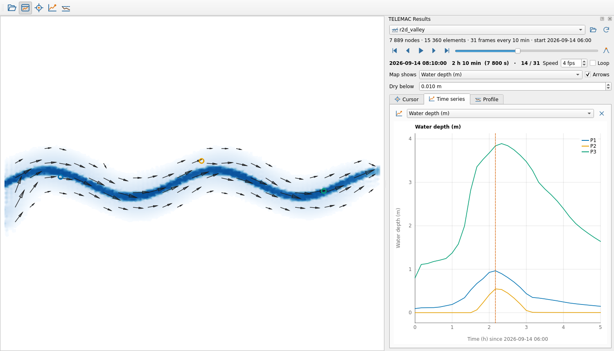

Release 0.4.0: results viewer with arrow controls, a calculator with spatial derivatives and time
statistics, discharges and volumes; mesher with a step-by-step workflow, straight, curved and meandering
channel templates, local coordinates, node editing of existing meshes and export to eight formats.

**[User guide](docs/guide/README.md)**: installation, results, calculator, mesh workflow, channel templates,
editing meshes, formats, every Processing tool, Python scripting and troubleshooting.

## Build a mesh

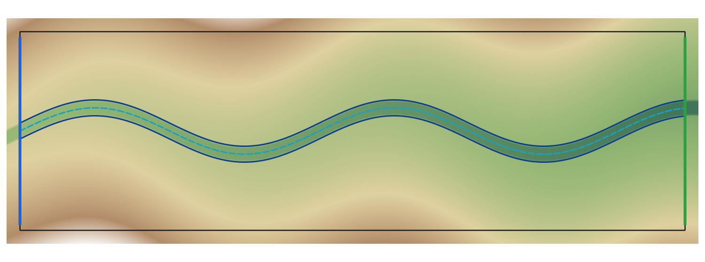

Open the **Mesh workflow** panel (toolbar) and go through its five steps. Every step runs a Processing
tool, so the same work can be done from the Processing toolbox, a model or a script.

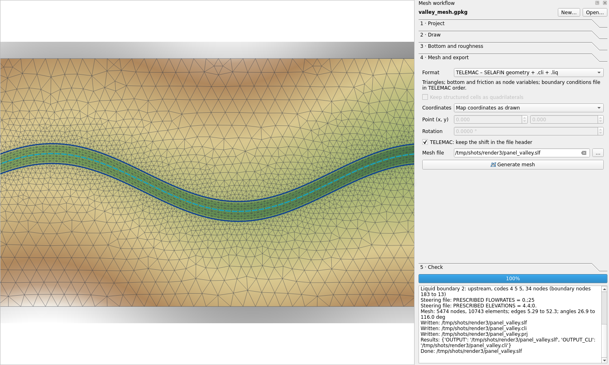

**1 · Project.** *New…* creates a mesh project: a GeoPackage with one styled layer per kind of object,
added to the map. Choose a map CRS, or **local coordinates** for a laboratory flume or a schematic
channel, drawn from (0, 0). The project keeps its settings (sizes, bottom formula, export choices).
*Channel or flume template…* draws a laboratory flume or a schematic channel from (0, 0), with inlet and
outlet lines, a structured mesh and its bed as a formula (bed level, slope along the axis, flat or
trapezoidal section), so no DEM is needed. Three planforms:

- **Straight**: a rectangle of a given length.
- **Bend**: straight inlet, circular bend (radius on the axis, angle such as 90° or 180°, left or right),
  straight outlet: the classic curved-flume experiments.
- **Meanders**: a sine-generated curve (Langbein & Leopold), the shape of natural meanders, with its
  wavelength along the axis, largest deflection angle and number of wavelengths.

The template is for flumes and their numerical replicas, checks against analytical solutions (normal depth,
backwater, bend superelevation), sensitivity tests (mesh size, friction, turbulence) and idealised reaches
for teaching or sediment studies. A natural river is drawn on the map instead (domain, channel banks and
axis over a DEM). In curved channels the cross-sections of the structured mesh are normal to the axis, and
the bed formula uses the channel coordinates `s` (distance along the axis) and `n` (distance across it, left
positive), e.g. `0.30 - 0.001*s + clip((abs(n) - 0.3)/1.5, 0, 0.2)`; any project with a channel axis can use
them.

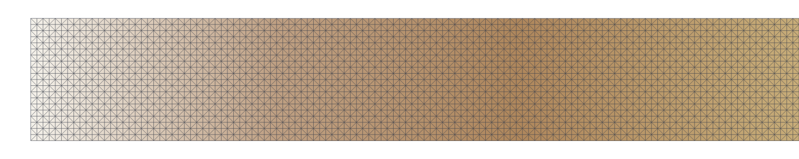

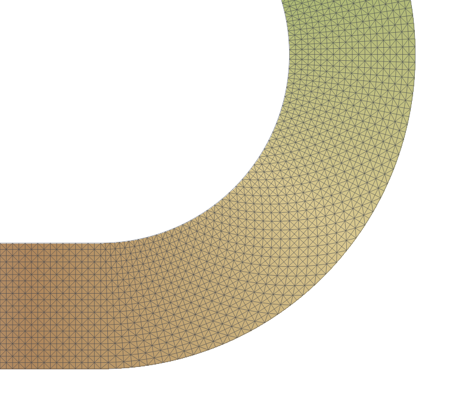

**2 · Draw.** Pick a layer and draw with QGIS's editing tools (snapping, tracing, copy from other layers):

| Layer | What it is for | Fields |
| --- | --- | --- |
| `domain` | Area to mesh; holes are islands | `name`, `size` (optional) |
| `islands` | Areas left out of the mesh | `name` |
| `refinement_areas`, `refinement_points` | Local element size | `size` |
| `constraint_lines` | Lines the mesh follows: `breakline` keeps every vertex (dikes, roads, banks), `guide` is resampled to the local size | `name`, `mode`, `size` (optional) |
| `fixed_points` | Nodes that must exist (gauges, structures) | `name`, `size` (optional) |
| `channels` | A channel as a structured strip: left bank, right bank, optional axis | `channel`, `role`, `nodes_across`, `spacing` |
| `grid_zones` | Rectangles meshed as regular grids | `name`, `dx`, `dy` |
| `roughness_zones` | Material id per element and a friction value per node | `name`, `material`, `friction` |
| `boundaries` | Boundary conditions | `name`, `type` (wall, Q, H, QH, UV, UVH, free, waves or a code like 455), `value` |

*Check the drawing* reports what the mesher will see (islands, structured parts, lines) before meshing.

**3 · Bottom and roughness.** Rasters in priority order (the first one that covers a node wins), survey
points (linear on their triangulation), then a formula of x and y such as `0.3 - 0.002*x` (or of `s` and
`n` along a channel axis); nodes nothing covers take the nearest value. Roughness zones give TELEMAC a `BOTTOM FRICTION` variable, which
TELEMAC-2D reads from the geometry file, and other programs a material id per element.

**4 · Mesh and export.** Default size (left on *auto*, about 1/40 of the square root of the domain area),
growth rate, smoothing; the output format; whether structured cells stay quadrilaterals; and the
coordinates of the file.

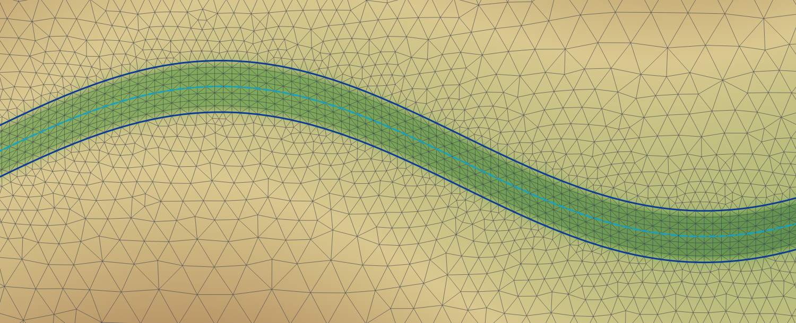

**5 · Check.** A mesh quality layer (angles, edge length, elements with all their nodes on the boundary),
and *Find* a node or an element by its number, as TELEMAC listings print them.

### How the mesh is built

Unstructured triangles fill the domain with an element size that grows away from refinement objects at
the growth rate. Domain edges and guide lines are resampled to the local size, breaklines keep their
vertices, line crossings become nodes. Interior nodes come from hexagonal lattices, one per size level,
kept clear of every constraint line. QGIS's GEOS library makes the Delaunay triangulation; constraint
lines missing from it are split until they are edges. Oversized triangles get a node at their
circumcentre, interior nodes are smoothed without ever inverting an element, structured channel strips
and grids are stitched in node for node, and triangles with three boundary nodes are fixed by an edge
flip. A 30 000-node mesh takes about 8 seconds.

### Formats

The mesher is built for TELEMAC; the same mesh goes to other programs from step 4 or from
*Export or convert mesh*:

| Format | For | Boundaries and roughness |
| --- | --- | --- |
| SELAFIN `.slf` + `.cli` + `.liq` | TELEMAC-2D/3D and the TELEMAC suite | `.cli` in TELEMAC order, `.liq` template, `BOTTOM FRICTION` |
| SMS 2DM `.2dm` | BASEMENT, TUFLOW FV, SMS, QGIS | nodestrings for open boundaries, `MAT` ids |
| Gmsh `.msh` (2.2) | Gmsh and solvers that read it | physical lines per boundary, physical surfaces per material |
| GiD mesh `_gid.msh` | GiD and GiD-based programs such as Iber | material number per element |
| UGRID `.nc` | Delft3D FM / D-HYDRO | elevation at nodes |
| MIKE 21 FM `.mesh` | MIKE 21 FM | boundary code per node |
| ADCIRC `.14` | ADCIRC, SCHISM (`hgrid.gr3`) | open and land boundary node lists |
| HEC-RAS `.gpkg` | HEC-RAS (RAS Mapper) | perimeter, breaklines, refinement regions, boundary lines |

HEC-RAS builds its own cells from a perimeter, breaklines and cell spacings, so the drawing is exported
for it, not the triangles. Programs that accept quadrilaterals can keep the structured cells as quads.
The SELAFIN, 2DM, UGRID and MIKE files are read back by QGIS in the tests, and the Gmsh file by meshio;
the GiD and ADCIRC files follow their published layouts but have not been loaded in Iber or ADCIRC yet.

### Coordinates

A file can keep the map coordinates, or move the lower-left corner (or any point) to (0, 0), with an
optional rotation of the axes. For TELEMAC the shift can be stored in the file header: TELEMAC computes
near (0, 0) and QGIS still shows the mesh in place. Otherwise a `_frame.txt` note next to the file gives
the shift and the rotation to go back to map coordinates.

### Edit an existing mesh

*Edit node values of a mesh* changes a variable of an existing SELAFIN geometry without remeshing: same
nodes, elements, boundary numbering, origin and date, so its `.cli` still fits (it is copied next to the
new file). New values come from rasters, survey points, a formula (of x, y or s, n along an axis line) or a
constant; they can replace the old values, be added to them, raise them (keep the higher: fills, dikes)
or lower them (keep the lower: dredging, cut channels), on the whole mesh or inside polygons with a
transition width along the polygon edge. A new variable (such as `BOTTOM FRICTION`) is added when the
file does not have it. Typical edits: a new survey over a reach, a dredged channel, a dike crest, a
friction zone. For new boundary conditions on an existing mesh use *Boundary conditions from lines*.

### Validation

- The valley demo (2 km meandering river) was rebuilt from three layers and a DEM with
  `scripts/make_mesh_demo.py` (5 474 nodes, smallest angle 26.9°); TELEMAC-2D v9.1.1 ran the flood
  with a volume error of 1e-9 m³.
- A 20 m × 1 m laboratory flume in local coordinates (`scripts/make_flume_demo.py`), friction n = 0.025
  written into the geometry file and 0.05 in the steering file, ran in TELEMAC-2D: TELEMAC reports
  reading the friction from the geometry file, and the flow settles at 0.1448 m, against a normal depth
  of 0.1439 m for n = 0.025 (0.218 m for n = 0.05), with outflow equal to inflow
  (`tests/data/demo_flume/run_summary.txt`).
- A 180° laboratory bend from the channel template (`scripts/make_bend_demo.py`: 1 m wide, radius 2 m,
  slope 0.001 along the axis, 5 187 nodes) ran in TELEMAC-2D. The plugin's *Integrals and fluxes* gives
  0.04999 to 0.05001 m³/s through five sections for 0.05 m³/s in, and the water surface stands 6.3 mm
  higher on the outer bank at the apex, against 6.0 mm by Rozovskii's U²W/(gR)
  (`tests/data/demo_bend/run_summary.txt`).
- Liquid boundaries are numbered as TELEMAC numbers them (from the boundary point with the smallest
  x + y, as BIEF's FRONT2 does); the bend, where the outlet comes first, is the test case.
- Rebuilt with the current tools, the valley mesh, its `.cli` and its `.liq` are byte for byte those of 0.2.0.
- The calculator's operators are checked against exact fields (linear fields, solid-body rotation, pure
  strain, quadratics) and for convergence; section discharges are exact for the model's interpolation.
- 48 library tests and 29 QGIS tests pass on QGIS 3.44.14 (Qt5) and 4.2.3 (Qt6).

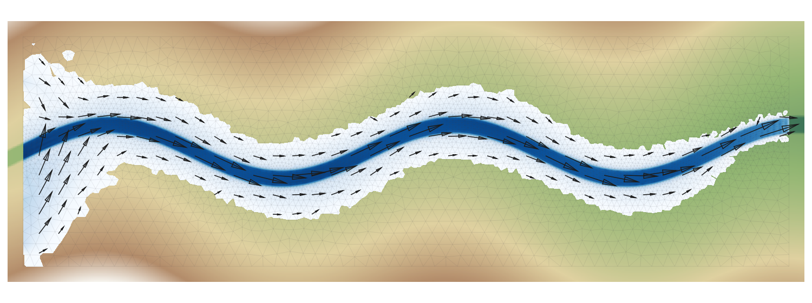

## View results

- **Opens 2D and 3D SELAFIN results** as QGIS mesh layers with readable names ("Water depth (m)",
  "Velocity (m/s)"), a style per variable and velocity arrows. QGIS cannot read 3D SELAFIN files, so
  the plugin writes a 2D file next to the result (depth average, bottom, surface or any plane) and
  opens that.
- **Arrows you control** (*Arrow settings* in the Results panel): on a regular screen grid with a spacing
  in pixels, so fine parts of the mesh are not cluttered and the density stays the same at every zoom, or
  on every node; length proportional to the speed with the fastest arrow fitting the spacing (no
  overlap), proportional with a fixed scale in mm per m/s (to compare runs), or all the same length;
  hidden below a speed; one colour or coloured by magnitude. The panel shows the reference length.
- **One clock.** The QGIS Temporal Controller, the Results panel, the plots and the cursor all show the
  same time step. Play, step, loop, or jump to the flood peak.
- **Live cursor:** every variable under the mouse at the current time, interpolated inside the triangle.
- **Probes:** click points to get time series; the plot marks the current time and a click on the plot
  moves the clock.
- **Profiles:** draw a line to see the bed and the water surface along it, updated as time moves. Dry
  cells (below a depth you choose) are left blank, both in the profile and on the map.
- **Running simulations:** a result that TELEMAC is still writing can be opened; *Refresh* reads the
  new time steps.
- **Calculator:** new variables from formulas, written to a new SELAFIN file, with spatial calculus on the
  mesh (`ddx`, `ddy`, `grad`, `div`, `curl` for vorticity, `strain`, `okubo_weiss`, `laplacian`), time
  statistics (`tmax`, `tmin`, `tmean`, `tstd`, `tint`, `tpeak`, `tfirst`, `tlast`) and the time derivative
  `ddt`. One output per line, `NAME [UNIT] = expression`, e.g. `VORTICITY [1/S] = where(H > 0.01,
  curl(U, V), 0)` or `HMAX [M] = tmax(H)`; two outputs named `... X` and `... Y` are shown as a vector.
- **Integrals and fluxes:** discharge through section lines (exact for the model's interpolation, the
  line is cut at every mesh edge), flux of a concentration, line integrals and means, and area integrals
  over polygons or the whole mesh (`H` gives the volume), for every time step.
- **Processing algorithms** for batch work and the Model Designer:

| Algorithm | Does |
| --- | --- |
| SELAFIN file information | Dimensions, variables, frames, start date, precision, mesh quality; warns about float32 coordinate precision |
| Extract 2D from a 3D result | Depth average, bottom, surface or any plane |
| Extract frames and variables | Subset a file, e.g. `0:100:5` and `WATER DEPTH, BOTTOM` |
| Time series at points | Values at every point of a layer for every time step (table) |
| Mesh boundary as lines | Outer boundary and islands as a line layer |
| Calculator | New variables: algebra, gradients, divergence, vorticity, strain, time maxima and integrals |
| Integrals and fluxes | Discharge through lines, fluxes, line and area integrals, volumes, per time step |

Mesh tools in Processing (group *Mesh*): New mesh project, Channel or flume template (straight, bend,
meanders), Generate mesh, Export or convert mesh, Extract part of a mesh, Structured channel mesh, Regular
grid mesh, Edit node values of a mesh, Boundary conditions from lines, Mesh quality.

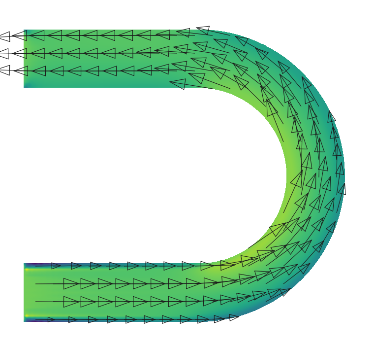
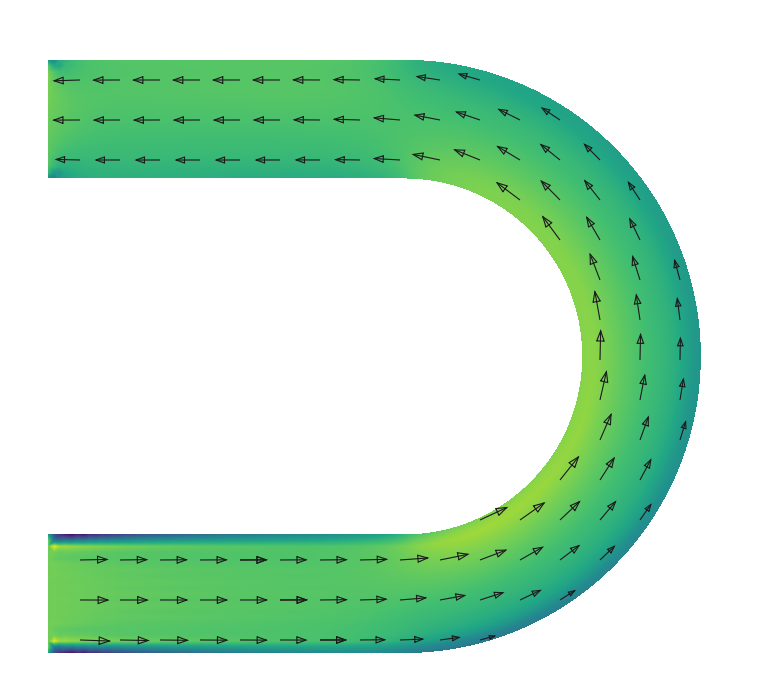

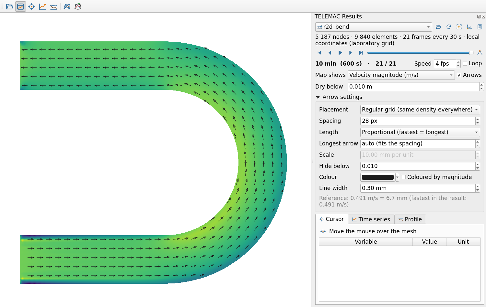

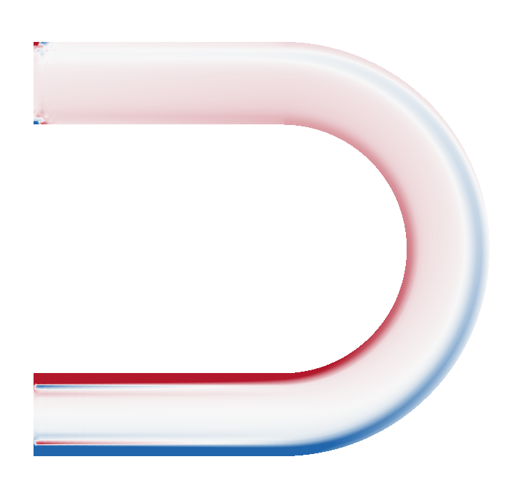

## Install

Requires QGIS 3.44 LTR or QGIS 4.x on Windows, Linux or macOS. Nothing else: the plugin only uses
NumPy, which ships with QGIS.

1. Download `telemac_toolkit-0.4.0.zip` from the [Releases](https://github.com/alphavarez/telemac-toolkit/releases) page
   (or install *TELEMAC Toolkit* directly from the QGIS plugin manager once it is published there).
2. In QGIS: *Plugins → Manage and Install Plugins → Install from ZIP*, choose the file, *Install Plugin*.
3. A *TELEMAC Toolkit* toolbar and menu appear. Experimental plugins must be allowed in the plugin
   manager settings if QGIS asks.

Mesh projects made with 0.2.0 still open: their `outline`, `density`, `hard_lines`, `soft_lines`,
`hard_points` and `grids` layers are read as `domain`, `refinement_areas`, breaklines, guide lines,
`fixed_points` and `grid_zones`.

## Quick start with results

1. *Open TELEMAC result…* (or drag a `.slf` file onto QGIS).
2. The *TELEMAC Results* panel opens. Use the play controls or the QGIS Temporal Controller.
3. *Map shows* chooses the coloured variable; *Arrows* chooses the vector drawn as arrows (velocity, unit
   discharge, wind…; choosing a vector on the map moves the arrows to it) and *Arrow settings*
   sets their spacing, length and colour; *Dry below* sets the depth under which cells are not drawn.
   The buttons next to the result list zoom to it, set its coordinate system and open the Calculator.
4. Tabs: **Cursor** (live values), **Time series** (click the map with the probe tool, right-click to
   clear), **Profile** (click vertices, right-click to finish).
5. Right-click any plot to copy its data, save it as CSV, or save a PNG.

### Coordinate reference system of results

SELAFIN files carry no CRS. The plugin uses, in this order:

1. a `.prj` file next to the result (`results.prj` or `results.slf.prj`, WKT or `EPSG:xxxx`);
2. the project CRS, when the coordinates lie in its area of use (a 20 m flume with x from 0 to 20 does
   not fit UTM, a mesh at x = 512 000 does);
3. otherwise it asks: local laboratory coordinates or a map CRS, with the coordinates of the file and a
   check of the choice, and can save the answer as a `.prj` so the file opens directly next time.

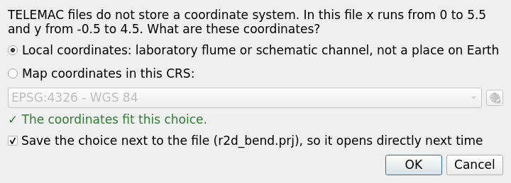

After opening, the map is adjusted so the result is visible: QGIS only zooms for the first layer of a
project, so a result opened after a mesh project could stay off screen. A project in local laboratory
coordinates and a map CRS cannot be drawn together; the project then takes the CRS of the result. The
zoom button in the Results panel re-centres the map at any time (or *Zoom to Layer* on the layer). QGIS's
status bar shows "Unknown CRS" for the local grid, as for any CRS without an EPSG code; the Results and
Mesh panels name it.

The origin offset stored in the file (IPARAM 3 and 4) is applied, so coordinates are absolute. TELEMAC's
own Python tools show coordinates relative to that offset.

## Using the libraries without QGIS

`telemac_toolkit/telemac_io` (SELAFIN, `.cli`) and `telemac_toolkit/mesher` (generator, writers) are
pure Python + NumPy:

```python
import sys; sys.path.insert(0, "telemac_toolkit")
from telemac_io import SelafinFile, write_selafin

with SelafinFile("r2d_valley.slf") as slf:
    print(slf)                                   # dimensions, variables, frames
    depth = slf.read("WATER DEPTH", frame=-1)    # last frame
    ts = slf.series("FREE SURFACE", nodes=[10])  # time series, read lazily
    print(slf.datetimes[0], slf.times[-1])

write_selafin("geo.slf", x, y, ikle, {"BOTTOM": z}, units={"BOTTOM": "M"})
```

The reader takes single and double precision, big and little endian, 2D and 3D files, files with a date
record, and incomplete files from running simulations. The writer stores large coordinates with an
origin offset so float32 keeps sub-centimetre resolution.

## Development

```text
telemac_toolkit/          the QGIS plugin (this folder is what the zip contains)
  telemac_io/             SELAFIN, .cli, mesh utilities, variable catalogue (no QGIS)
  mesher/                 generator, structured parts, interpolation, boundaries, neutral mesh, writers (no QGIS)
  qgis_bridge/            results loading, styles, time sync; mesh project, GEOS, rasters, export chain
  gui/                    Results panel, Mesh workflow panel, plots, map tools
  tt_processing/          Processing provider and algorithms
tests/core                library tests (pytest, plain Python)
tests/qgis                integration tests in a real headless QGIS
tests/data                sample files and run summaries (see tests/data/README.md)
scripts/                  demo cases, screenshots, packaging, Processing reference generator
docs/guide/               user guide (Markdown, shown by GitHub)
```

Tests:

```sh
python -m pytest tests/core                                   # any Python with NumPy
QT_QPA_PLATFORM=offscreen <qgis-python> -m pytest tests/qgis  # QGIS 3.44 and 4.x
```

## Roadmap

| Phase | Content |
| --- | --- |
| 1. Results (0.1.0) | SELAFIN library, results as mesh layers, time controls, cursor, probes, profiles |
| 2. Mesh (0.2.0 to 0.4.0) | Generator with structured parts, workflow panel, local coordinates, straight, bend and meander templates, node editing, boundary conditions, eight output formats, quality, cut |
| 3. Analyse (0.4.0 started) | Calculator with spatial and time operators, discharges and volumes (done); arrival time, duration, hazard, scenario differences, listing parser (next) |
| 2.x Mesh, next | Boundary editor on the mesh, steering file template, local remeshing of an existing mesh, branched channels, import of `.i2s`/`.i3s`/`.t3s` line files |
| 4. Extend | 3D tools, partitioned results, streamlines, HEC-RAS geometry file writer |

## Credits

Written as an open, QGIS-native alternative for TELEMAC users of Blue Kenue (National Research Council
Canada) and Q4TS (EDF and Oslandia); no code from either is used. Sample results come from the
TELEMAC-MASCARET examples as redistributed by xarray-selafin.

## Licence

GPL-3.0-or-later. See `LICENSE`.
