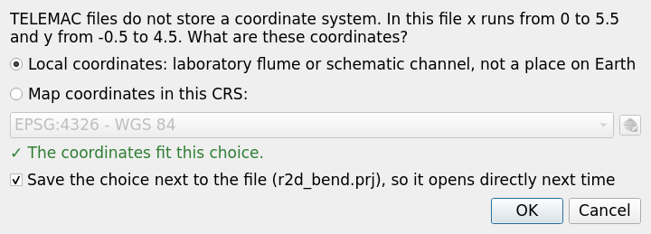
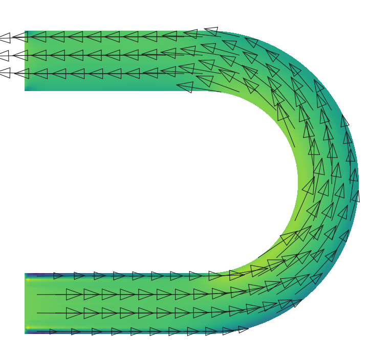
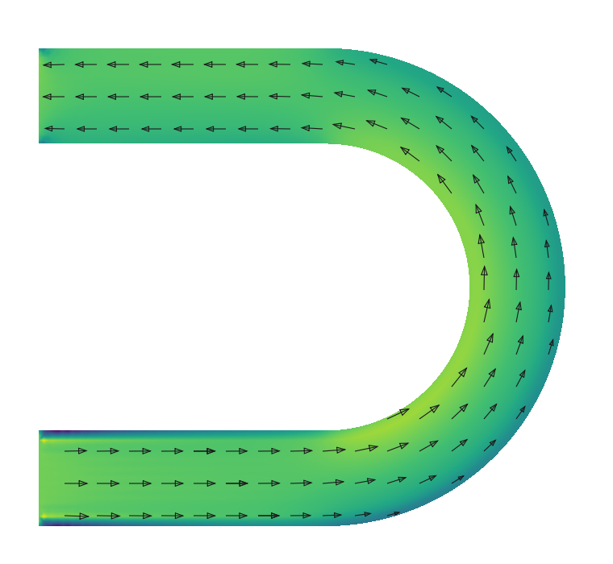

# 3. Ver resultados

## Abrir un resultado

- *Open TELEMAC result…* (barra de herramientas o menú), o arrastra archivos `.slf`, `.res` o `.srf` a QGIS.
- Los **resultados 2D** se abren como capas de malla de QGIS con nombres de variable legibles ("Water depth
  (m)", "Velocity (m/s)") y un estilo según el tipo de variable: azules para el tirante, una rampa de
  terreno para el fondo, Viridis para la velocidad y una rampa de flujo crítico para el número de Froude.
- Los **resultados 3D** (TELEMAC-3D): QGIS no puede leer archivos SELAFIN 3D, así que el plugin pregunta qué
  mostrar (promedio en la profundidad, plano del fondo, plano de la superficie o cualquier plano), escribe un
  archivo 2D junto al resultado (`nombre_2d_average.slf`…) y abre ese. El archivo 2D se reutiliza mientras
  sea más nuevo que el resultado.
- Se reconocen los nombres de variable **en francés o en inglés**.
- **Simulaciones en ejecución**: se puede abrir un resultado que TELEMAC todavía está escribiendo. El botón
  **refresh** lee los pasos de tiempo nuevos y salta al último.
- Los resultados guardados en un proyecto de QGIS se vuelven a conectar al panel cuando se reabre el
  proyecto.

La línea de información bajo la lista de resultados indica el número de nodos, elementos y cuadros, el
intervalo de salida, la fecha de inicio si el archivo la tiene, el sistema de coordenadas y las
advertencias (precisión float32 con coordenadas grandes, un último cuadro incompleto, o un subdominio de
una corrida en paralelo que primero hay que unir).

## Coordenadas de un resultado

Los archivos SELAFIN guardan x e y pero no un sistema de referencia de coordenadas (SRC). El plugin decide
en este orden:

1. **Un archivo `.prj` junto al resultado** (`r2d.prj` o `r2d.slf.prj`, en WKT o como `EPSG:xxxx`).
2. **El SRC del proyecto**, cuando las coordenadas del archivo caen dentro del área de uso de ese SRC. Un
   canal de 20 m con x de 0 a 20 no cabe en la zona UTM 14N; una malla en x = 512 000, y = 2 155 000 sí.
3. En otro caso **pregunta**: coordenadas locales (canal de laboratorio o canal esquemático) o un SRC de
   mapa. El cuadro de diálogo muestra el rango de las coordenadas y comprueba tu elección ("✓ The
   coordinates fit this choice" o una advertencia). Con *Save the choice next to the file* escribe el
   `.prj`, y la próxima vez el archivo se abre directamente.

Después de abrir, el mapa se **ajusta para que el resultado quede a la vista**: la primera capa de un
proyecto fija el SRC del proyecto y el zoom; si un resultado queda fuera de la vista actual, se hace zoom a
él; y un proyecto en coordenadas locales no puede mostrar un resultado en un SRC de mapa (ni al revés), así
que el proyecto toma el SRC del resultado. Para cambiar el SRC después, usa el **botón de coordenadas** del
panel de resultados; para volver a centrar el mapa, usa el **botón de zoom** (o clic derecho en la capa →
*Zoom a la(s) capa(s)*).

La barra de estado de QGIS muestra **"SRC desconocido"** (*Unknown CRS*) para coordenadas locales. Es la
etiqueta que QGIS usa para cualquier SRC sin código EPSG; no es un error. Los paneles de resultados y de
malla lo llaman "local coordinates".

Se aplica el desplazamiento del origen que algunos archivos guardan en su encabezado (IPARAM 3 y 4), de modo
que las coordenadas son absolutas.

## Tiempo

El panel de resultados, el Controlador temporal de QGIS, las gráficas y el cursor comparten un mismo reloj.

- Botones de **primero / anterior / reproducir-pausa / siguiente / último** y el deslizador; **Speed**
  (velocidad) en cuadros por segundo; **Loop** (repetir).
- La etiqueta de tiempo muestra el tiempo transcurrido ("8 h (28 800 s)"), el número de cuadro y, cuando el
  archivo tiene fecha de inicio, la fecha y la hora.
- **Peak** (botón al final del deslizador): salta al cuadro en el que la variable que muestra el mapa es
  máxima, en el primer punto de sonda si hay uno, y si no, de su promedio sobre la malla.
- Un clic en una gráfica de serie de tiempo mueve el reloj a ese instante.

## Qué muestra el mapa

- **Map shows**: cualquier variable del archivo, más las magnitudes de los vectores (velocidad, caudal
  unitario, viento) cuando el archivo tiene las componentes pero no la magnitud.
- **Arrows**: el vector que se dibuja como flechas (*Off*, *Velocity*, *Unit discharge*, *Wind*…, todos los
  vectores del archivo). Si eliges un vector en *Map shows*, las flechas pasan a ese vector, de modo que
  los colores y las flechas muestran la misma cantidad. Un escalar (tirante, superficie libre, fondo…) no
  tiene dirección: conserva las flechas que se mostraban, al inicio las de velocidad, que es la vista usual
  del tirante con la dirección del flujo encima. Los vectores son los pares `… U / … V`,
  `… ALONG X / … ALONG Y` y `… SUIVANT X / … SUIVANT Y`, los nombres que QGIS lee como vectores; otros pares
  `X / Y` (por ejemplo `VENT X`) son dos mapas separados.
- **Dry below**: el tirante menor que este valor no se dibuja (queda transparente), en el mapa y en los
  perfiles.

Los estilos se pueden ajustar más en las propiedades de la capa (*Simbología*), como en cualquier capa de
malla de QGIS.

### Arrow settings (ajustes de las flechas)

Abre **Arrow settings** en el panel de resultados. Los cambios se aplican de inmediato, se recuerdan para
los resultados siguientes y se guardan con el proyecto de QGIS.

| Ajuste | Qué hace |
| --- | --- |
| **Placement** (colocación) | *Regular grid*: una flecha por celda de una cuadrícula en pantalla, interpolada desde la malla, de modo que las zonas finas de la malla no se saturan y la densidad es la misma con cualquier zoom. *Every mesh node*: una flecha por nodo (las mallas densas se llenan demasiado). |
| **Spacing** (separación) | Separación de la cuadrícula en píxeles de pantalla. Menor = más flechas. En canales angostos usa 15–25 px para que las flechas caigan dentro del canal. |
| **Length** (longitud) | *Proportional (fastest = longest)*: longitud proporcional a la velocidad; el valor más rápido de todo el resultado recibe la flecha más larga. *Proportional, fixed scale*: un número fijo de mm por m/s, igual para todos los resultados; úsalo para comparar escenarios. *Same length*: solo dirección (el color del mapa indica la velocidad). |
| **Longest arrow** (flecha más larga) | Longitud de la flecha más rápida (o de todas las flechas con *Same length*). *auto* = 90 % de la separación, así las flechas nunca se traslapan. |
| **Scale** (escala) | mm por unidad (m/s) para el modo de escala fija. |
| **Hide below** (ocultar por debajo de) | Las flechas con magnitud menor que esta no se dibujan (terreno seco, agua en reposo). |
| **Colour** (color) | Un solo color, o *Coloured by magnitude* con la rampa de velocidad. |
| **Line width** (grosor de línea) | En mm. |

La línea gris bajo los ajustes da la **referencia**: "0.491 m/s = 6.7 mm (fastest in the result: 0.491
m/s)". Puedes ponerla en la leyenda de un mapa o en el pie de figura de un informe.

## Cursor, series de tiempo y perfiles

Pestaña **Cursor**: activa el cursor en vivo y mueve el ratón sobre la malla. Se interpola cada variable, al
tiempo actual, dentro del triángulo que está bajo el ratón, además de la magnitud y la dirección (rumbo, 0°
= norte) de cada vector.

Pestaña **Time series**: activa la sonda y haz clic en puntos de la malla (clic derecho los borra). Elige la
variable sobre la gráfica. Una línea vertical marca el tiempo actual; un clic en la gráfica mueve el reloj.

Pestaña **Profile**: activa la herramienta de perfil, haz clic en los vértices de una línea y termina con
clic derecho. *Water profile* dibuja el fondo y la superficie del agua (las partes secas quedan en blanco);
se puede elegir cualquier otra variable. El perfil sigue al reloj, así que al reproducir la animación el
perfil se anima.

**Todas las gráficas**: clic derecho para copiar los datos, guardarlos como CSV o guardar la imagen como
PNG.

## Otras herramientas de resultados

En *Complementos → TELEMAC Toolkit* y en la caja de herramientas de Procesos: información del archivo
SELAFIN (dimensiones, variables, precisión, calidad de la malla), *Extract 2D from a 3D result*, *Extract
frames and variables*, *Time series at points* (una tabla para cada punto de una capa), *Mesh boundary as
lines* y la [calculadora y las integrales](04-calculadora-integrales.md).

[← Primeros pasos](02-primeros-pasos.md) · [Contenido](README.md) · [Siguiente: Calculadora →](04-calculadora-integrales.md)
