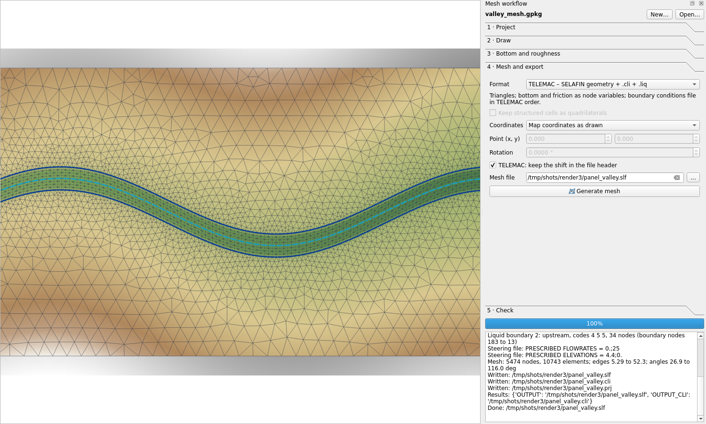
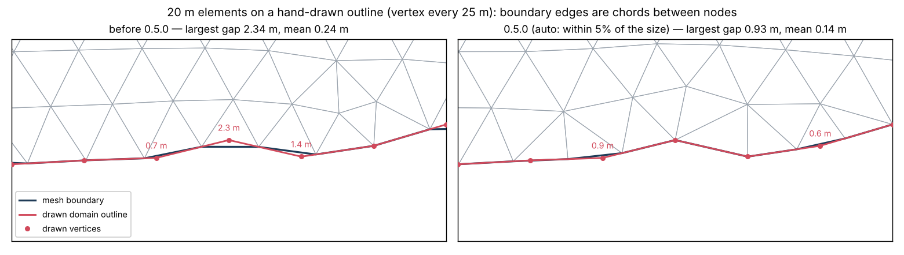
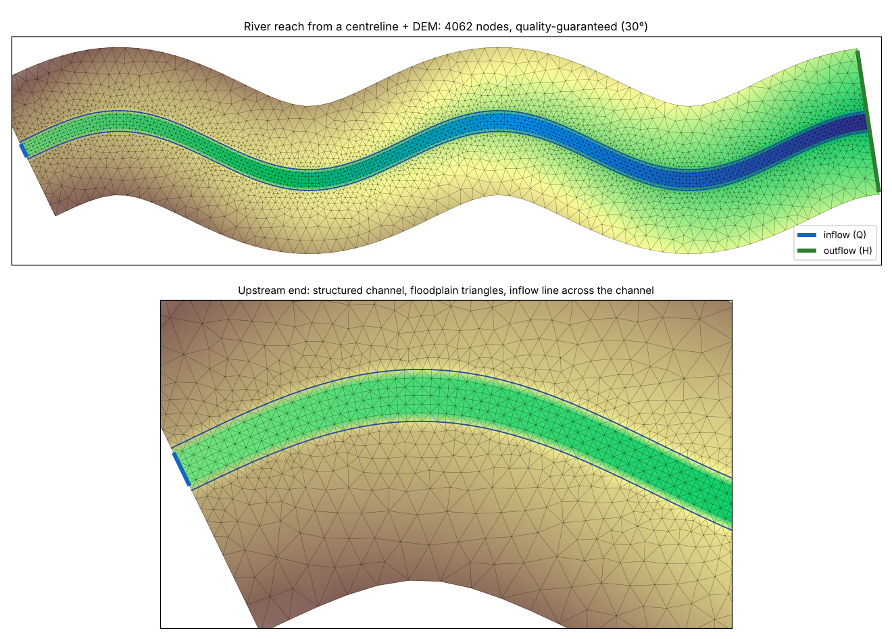
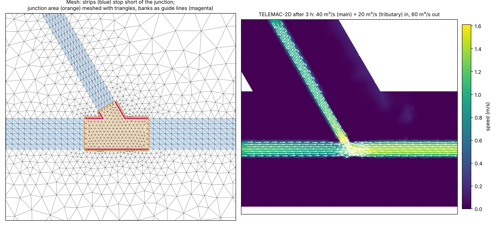

# 5. El flujo de trabajo de la malla

Barra de herramientas → **Mesh workflow panel**. El panel tiene seis pasos. Cada paso ejecuta una
herramienta de Procesos, de modo que el mismo trabajo se puede hacer desde la caja de herramientas, desde un
modelo o desde un script ([referencia](09-referencia-procesos.md)).

## Paso 1 · Proyecto

- **New…** crea un *proyecto de malla*: un GeoPackage con una capa vacía y con estilo para cada tipo de
  objeto, agregada al mapa en un grupo, más una tabla de ajustes. Responde **Sí** a **coordenadas locales**
  (un canal de laboratorio o un canal esquemático dibujado desde (0, 0)); **No** para elegir un SRC de mapa.
  Usa un SRC proyectado en metros, nunca uno geográfico: los tamaños quedarían en grados.
- **Open…** abre un proyecto existente (incluidos los de la 0.2.0). Cuando las capas de un proyecto ya
  están en el mapa, el panel las encuentra solo.
- **Coordinates** muestra el SRC del proyecto ("local (laboratory)" o un código EPSG). Un SRC sin código EPSG
  (muchas veces el que viene en la definición propia de un MDE, como el ITRF92 UTM del INEGI) hace que QGIS
  liste las capas del proyecto con un `[ ]` vacío en los diálogos de las herramientas (donde normalmente
  muestra `[EPSG:32614]`). Las coordenadas siguen siendo correctas. Cuando el SRC tiene la misma proyección que
  uno EPSG (WGS 84, NAD83, México ITRF92 o ITRF2008 UTM, México ITRF2008 LCC), *New…* ofrece ese código, y al
  abrir un proyecto existente se ofrece asignárselo; las coordenadas no cambian.
- **Default size**: tamaño de elemento donde no se aplica ningún refinamiento, en metros. *auto* usa
  aproximadamente 1/40 de la raíz cuadrada del área del dominio (0.1 m para un canal de 20 m × 1 m, 25 m
  para un valle de 2 km²) y lo indica en el registro. Los tamaños están en las unidades del mapa (metros en
  un proyecto UTM). Un tamaño de 0.2 o 0.05 en un dominio de decenas de kilómetros pide miles de millones de
  nodos: *Generate mesh* estima primero el número de nodos y se detiene de inmediato, con un mensaje, si
  pasa del **Node limit** (2 millones por defecto; súbelo para un modelo grande, 0 quita la
  verificación). El generador necesita unos 1.5 s por cada 10 000 nodos en una laptop, así que 700 000
  nodos (un tramo de 100 km y 5 km de ancho, a 25 m) toman unos 2 minutos.
- **Growth rate**: qué tan rápido crece el tamaño al alejarse de las zonas refinadas (1.2 = 20 % por
  elemento). Un valor menor da una malla más suave y con más elementos.
- **Smoothing**: iteraciones que mueven los nodos interiores para mejorar los ángulos (8 es un buen valor por
  defecto).
- **Follow the outline within** (*auto* = 5 % del tamaño de elemento): cuánto puede apartarse el borde de la
  malla del contorno dibujado, de las islas y de las líneas guía. Sus nodos se colocan a lo largo del dibujo
  al tamaño de elemento, así que una arista de la malla es una cuerda recta entre dos puntos del dibujo: donde
  el dibujo se curva entre ellos, la arista corta la curva, hacia adentro en una curva convexa y hacia afuera
  en una cóncava. Las esquinas (que giran más de 30° a la escala de un elemento) siempre quedan como nodos;
  cualquier otro vértice dibujado también queda como nodo cuando quitarlo movería el borde más que esta
  distancia. El registro da la mayor distancia que queda (*Largest distance between the drawn lines and the
  mesh edges*). Pon una distancia en metros para un ajuste más fiel (0.01 m conserva prácticamente todos los
  vértices). Los detalles menores que medio elemento (los zigzags de una digitalización rápida) no se siguen,
  para que no creen triángulos alargados; el registro los cuenta. Las líneas de quiebre (breaklines) siempre
  conservan todos sus vértices.

  
- **Method**: *Balanced* coloca los nodos en patrones regulares y los suaviza (rápido, con cambios de tamaño
  suaves). *Quality-guaranteed* además refina hasta que cada triángulo alcanza el **Smallest angle** (de 20 a
  30°): los triángulos por debajo reciben un nodo en su circuncentro, o se divide el segmento de restricción
  al que ese nodo quedaría demasiado cerca. Agrega pocos nodos (de 7 a 10 en mallas de 4 000 a 5 000 nodos en
  las pruebas) y omite el suavizado final, que desharía la garantía. Dos tipos de triángulos pueden quedar
  por debajo del objetivo, y el registro los cuenta: los que tienen una arista en un canal o una cuadrícula
  estructurados (esas aristas son fijas) y los que están junto a una esquina del dibujo más aguda que el
  objetivo (una esquina de 15° no puede dar triángulos de 30°). Por encima de 30° el refinamiento no
  converge, así que el panel se detiene ahí.
  Los métodos de **Gmsh** (*Delaunay*, *Frontal-Delaunay*, *MeshAdapt*, *cuadriláteros*) necesitan el paquete
  opcional gmsh ([instalación](01-instalacion.md#opcional-gmsh)). El plugin sigue preparando todo lo que rodea al
  interior (contorno e islas remuestreados según el campo de tamaños, líneas de quiebre y sus cruces, puntos
  fijos, canales y cuadrículas estructurados) y Gmsh rellena el interior con su algoritmo, siguiendo el mismo
  campo de tamaños, sin agregar nodos en ninguna de esas líneas. El cosido, el fondo, las condiciones de
  frontera y los formatos de salida son iguales para todos los métodos. *Gmsh quadrilaterals* conserva sus
  cuadriláteros para los formatos que los aceptan; TELEMAC recibe cada uno como dos triángulos, cortado por la
  diagonal que da mejores ángulos. Véase [Comparar métodos de mallado](#comparar-métodos-de-mallado) más abajo
  para ver cómo difieren en un caso real.
- **Terrain tolerance** (apagado por defecto) y **Terrain smallest size**: tamaños según el terreno a partir del
  primer MDE marcado en el paso 3; véase [Mallado según el terreno](#mallado-según-el-terreno).
- **Suggest sizes from the DEM…**: véase [Tamaños a partir del MDE](#tamaños-a-partir-del-mde) más abajo.
- **Channel or flume template…** dibuja un canal de laboratorio, una curva o meandros con su fórmula del
  fondo; véase [Plantillas de canal](06-plantillas-de-canal.md).
- **River reach…** dibuja un río natural, o una red de ríos con confluencias; véase
  [Ríos naturales](#ríos-naturales-el-asistente-de-tramo-de-río) más abajo.

## Ríos naturales: el asistente de tramo de río

El asistente convierte un eje o dos líneas de margen en un río listo para *Generate mesh*; varios ejes que se
unen forman una red de ríos (véase [Redes de ríos](#redes-de-ríos-confluencias-y-bifurcaciones)).

| Dato | Las márgenes |
| --- | --- |
| Eje y un **ancho constante** | La mitad del ancho a cada lado, en secciones normales al eje suavizado. |
| Eje y un **MDE** | En cada sección se lee el terreno a lo ancho del río, se encuentra el fondo cerca del eje y cada margen se coloca donde el terreno sube por primera vez el **tirante a cauce lleno** sobre el fondo (buscado hasta el **ancho máximo**). Los anchos se suavizan a lo largo del río y el eje se mueve a la mitad entre las márgenes. |
| **Dos líneas de margen** | Una capa de líneas con ambas márgenes, en cualquier orden y sentido. Las secciones son normales a su línea media suavizada y las cortan ambas márgenes, así que las márgenes conservan la forma dibujada. |

Escribe en el proyecto:

- **Canal estructurado**: margen izquierda, margen derecha y eje con un vértice por sección, así que las
  celdas de la franja son normales al flujo, también en curvas. Con *Nodes across follow the width* (por
  defecto) el número de nodos a lo ancho cambia a lo largo del río para que queden a una separación entre
  secciones, aproximadamente: donde el río se ensancha o se estrecha, una fila de triángulos agrega o quita
  un nodo a cada lado del eje, como mucho cada dos filas, y las demás filas siguen siendo celdas. Nunca baja de
  7 nodos a lo ancho, así que una entrada tiene al menos 5 nodos líquidos: con menos, el caudal entra como un
  chorro por la mitad del cauce, puede volverse supercrítico y secar la frontera (TELEMAC se detiene con
  *DEBIMP*). Indica *Nodes across* para mantenerlo constante (un número impar, por el eje).
- **Dominio**: el río más el **ancho de la planicie** a cada lado, con extremos rectos normales al eje. Con
  *Keep the domain of the project* se usa tu propio dominio y el tramo se recorta a las secciones que caen
  dentro de él.
- **Líneas de frontera**: entrada (Q) a lo ancho del cauce en el extremo aguas arriba, salida (H) a lo ancho
  de todo el extremo aguas abajo del dominio, para que el agua de la planicie pueda salir. Cualquiera de las
  dos puede cubrir solo el cauce o todo el extremo. Las líneas terminan un poco antes de sus extremos, así
  que los nodos de las márgenes y de las esquinas siguen siendo paredes. El caudal y el nivel son opcionales;
  defínelos después en la capa de fronteras o en el archivo `.liq`.
- **Tamaño por defecto**, si el proyecto no tiene: el tamaño de elemento de la planicie, o cuatro veces la
  separación entre secciones.

**Sentido**: con un MDE el río se orienta para correr aguas abajo, del fondo más alto al más bajo, y el
registro lo indica. Sin MDE, dibuja el eje en el sentido del flujo.

**Líneas irregulares y curvas cerradas**: el eje se suaviza a lo largo de la *longitud de suavizado* (por
defecto, el ancho) antes de trazar las secciones. En una curva con radio menor que la mitad del ancho, las
secciones vecinas se cruzarían en la margen interior, o dejarían ahí celdas mucho más cortas que anchas. Solo
se giran las secciones de esa zona (mezcladas con direcciones suavizadas a lo largo de unas pocas longitudes
de suavizado), hasta que ninguna se cruza y ninguna celda de la margen interior es más corta que la
separación dividida por la *razón* (parámetro avanzado, 4 por defecto); en el resto del río las secciones
siguen normales al flujo. Las que todavía se cruzan se informan con su distancia a lo largo del río: edita
ahí las márgenes o usa una separación mayor.

**Cómo elegir los valores**:

- *Separación entre secciones*: la longitud de elemento a lo largo del río, en general de un quinto a un
  décimo del ancho (5–8 m para un río de 40 m).
- *Ancho de la planicie*: hasta el borde de la mayor avenida que vayas a modelar.
- *Tirante a cauce lleno*: la altura de la margen sobre el fondo; compara con el mapa los anchos que informa
  el registro (mínimo, máximo, mediana).

Después del asistente: marca el MDE en el paso 3 y ejecuta *Generate mesh* en el paso 4.

### Redes de ríos: confluencias y bifurcaciones

Da varios ejes en la capa de ejes: cada afluente termina sobre el río al que llega (puede quedarse un poco
corto o pasarse: hasta un cuarto del mayor ancho, al menos una separación), o líneas que se unen extremo con
extremo donde un río se divide. Las líneas deben ir aguas abajo; con un MDE cada línea se orienta por su
cuenta. Un **campo de ancho** opcional da a cada línea su propio ancho constante (los valores vacíos toman el
parámetro de ancho, o el MDE).

El asistente escribe:

- **Un canal estructurado por tramo** entre confluencias y extremos libres (`river_1`, `river_2`, …). Cada
  franja termina antes de sus confluencias: después de la última sección que todavía toca otro cauce, más un
  cuarto de su ancho.
- **La confluencia**: un *área de refinamiento* sobre el cauce que queda entre los extremos de las franjas, con
  el tamaño de la separación más fina de las franjas ahí, y sus **márgenes como líneas guía**. Alrededor de la
  confluencia cada margen se sigue hasta que se encuentra con la margen del brazo siguiente, así que la
  confluencia conserva sus esquinas; donde dos márgenes nunca se encuentran (el lado recto de un río
  principal) se unen de un lado al otro.
- **Dominio**: cada tramo ensanchado con la planicie, redondeado en las confluencias y recto en los extremos
  libres.
- **Líneas de frontera**: una entrada (Q) en cada extremo libre aguas arriba y una salida (H) en cada extremo
  libre aguas abajo. Un caudal dado en la herramienta va a la entrada solo cuando hay una; con varias,
  defínelo en cada una en la capa de fronteras.

Probado en una confluencia a 60° (río principal de 40 m de ancho, afluente de 25 m): 5 300 nodos, ángulo
mínimo de 27°, y en TELEMAC-2D entran 40 m³/s y 20 m³/s y salen 60 m³/s por la curva de gasto.

**Condiciones iniciales de una red**: un nivel a lo largo del eje del río principal deja seca la entrada de
un afluente (TELEMAC se detiene con *DEBIMP: problem on boundary number n*). Usa el modo *Depth above the bed
of the channel axes* de la herramienta de condiciones iniciales con la capa de canales del proyecto: cada nodo
toma el fondo del eje más cercano más el tirante, y todos los brazos empiezan con agua. La herramienta del
archivo de control avisa si una frontera de caudal empieza seca.

**Límites**:

- Una red crea su propio dominio (no *Keep the domain of the project*), a partir de ejes (no de líneas de
  margen).
- Dos confluencias más cerca que unos pocos anchos no dejan sitio para una franja entre ellas: la herramienta
  indica qué tramo es demasiado corto. Usa una separación menor o una sola confluencia.
- El MDE debe mostrar el cauce. Un MDE LiDAR sin batimetría muestra la superficie del agua, no el fondo: las
  márgenes se encuentran igual, pero el fondo debe venir de puntos de levantamiento o de una fórmula en el
  paso 3.

### Tamaños a partir del MDE

*Suggest sizes from the DEM…* (paso 1, o la herramienta *Suggest element sizes from a DEM*) lee el MDE marcado
en el paso 3 (o el único MDE del mapa), el dominio y los canales estructurados, y sugiere:

| Tamaño | Regla |
| --- | --- |
| Tamaño mínimo | Dos píxeles: un elemento más fino solo interpola los mismos píxeles; agrega nodos, no terreno. |
| Tolerancia del terreno | Más o menos la exactitud vertical de un MDE con esos píxeles: 0,05 m para LiDAR de 1 m, 0,1 m para 2 m, 0,2 m para 5 m, 0,5 m para 15 m (INEGI). |
| Tamaño por defecto (planicie) | El que pide el terreno mediano dentro del dominio con esa tolerancia; al menos cuatro píxeles, como mucho una vigésima parte del dominio, y lo bastante grueso para que el tamaño por defecto solo no pase de la mitad del presupuesto de nodos. |
| Ríos | Separación a lo ancho de un octavo del ancho (7 nodos o más a lo ancho) y 1,5 veces eso a lo largo. Un río más angosto que 8 píxeles no lo puede mostrar el MDE: la herramienta lo indica, y el fondo debe venir de puntos de levantamiento o de una fórmula. |
| Nodos y paso de tiempo | El número de nodos con el refinamiento por terreno (si pasa del presupuesto, 300 000 por defecto, la tolerancia se relaja) y el paso de tiempo con número de Courant 1 en los elementos más pequeños. |

**Apply** pasa el tamaño por defecto, la tolerancia del terreno y el tamaño mínimo al paso 1. Al marcar un MDE
en el paso 3 cuando el proyecto todavía no tiene tamaño por defecto, la sugerencia se escribe en el registro de
inmediato.

En el valle de prueba de 2 km (MDE de 2 m): tamaño mínimo 4 m, tolerancia 0,1 m, ríos de unos 48 m de ancho →
6 m a lo ancho y 8 m a lo largo.

## Paso 2 · Dibujar

La tabla enumera las capas del proyecto y cuántos objetos tiene cada una. Selecciona una capa y pulsa **Draw
in this layer** (o usa las herramientas de edición propias de QGIS: el autoensamblado, el trazado y el
copiado desde otras capas funcionan todos).

| Capa | Para qué sirve | Campos |
| --- | --- | --- |
| **Domain (holes are islands)** (dominio; los huecos son islas) | Área que se va a mallar. Los huecos de un polígono se dejan fuera. Varios polígonos se mallan juntos. | `name`, `size` (opcional) |
| **Islands (not meshed)** (islas, sin malla) | Áreas que se dejan fuera: edificios, pilas, islas secas | `name` |
| **Refinement areas** (zonas de refinamiento) | Elementos más finos (o más gruesos) en su interior | `size` (m) |
| **Refinement points** (puntos de refinamiento) | Tamaño de elemento en un punto: estructuras, estaciones de aforo | `size` |
| **Constraint lines** (líneas de restricción) | Líneas que la malla sigue. `mode` = **breakline** (se conservan todos los vértices: diques, coronas de camino, márgenes, muros) o **guide** (se remuestrea al tamaño local: talwegs, curvas de nivel). Modo vacío = breakline. | `name`, `mode`, `size` (opcional) |
| **Fixed points** (puntos fijos) | Nodos que deben existir: estaciones, descargas, esquinas de estructuras | `name`, `size` (opcional) |
| **Structured channels** (canales estructurados) | Un canal mallado como una franja estructurada: una línea de margen **izquierda** y una **derecha** y un **eje** opcional, distinguidos por `role` y agrupados por `channel` | `channel`, `role`, `nodes_across`, `spacing`, `across_spacing` (opcional) |
| **Structured grid zones** (zonas de malla estructurada) | Rectángulos (con cualquier orientación) mallados como cuadrículas regulares | `name`, `dx`, `dy` |
| **Roughness zones** (zonas de rugosidad) | Identificador de material por elemento y valor de fricción por nodo; donde se traslapan, ganan las zonas posteriores | `name`, `material`, `friction` |
| **Boundary conditions** (condiciones de frontera) | Líneas a lo largo del borde del dominio con un tipo de frontera | `name`, `type`, `value`, `tracer`, `codes` |

Consejos:

- El **autoensamblado** se configura al abrir un proyecto (desmarca *Set snapping, tracing and hover tips when
  a project opens* para conservar el tuyo): ensamblado a los vértices y aristas de las capas de dominio, islas,
  canales, líneas y fronteras a menos de 12 píxeles, en las intersecciones y sobre el objeto que se dibuja, con
  edición topológica; el **trazado** activado (pulsa **T** al dibujar para seguir el borde, así una línea de
  frontera corre exactamente sobre él); el panel de **digitalización avanzada** abierto (longitudes, ángulos y
  coordenadas exactas); y los **avisos al pasar el ratón**. El botón *Snapping for this project* lo vuelve a
  aplicar.
- **Avisos al pasar el ratón**: deja el ratón sobre un objeto para ver qué es y sus medidas: el tamaño de
  elemento de un dominio, su área, su perímetro y aproximadamente cuántos nodos tendrá con ese tamaño; el tamaño
  y los nodos de un área de refinamiento; el modo y la longitud de una línea; los nodos a lo ancho y la
  separación de secciones de un canal; el tipo de una frontera con sus códigos de TELEMAC, su valor y su
  trazador.
- **Formularios de atributos**: los campos tienen nombres claros y listas desplegables donde toman pocos valores
  (modo de las restricciones, papel en el canal, tipo de frontera y trazador).
- **Structured channels**: las márgenes van en el mismo sentido (el plugin invierte una si hace falta);
  `nodes_across` con un eje debe ser impar; `spacing` es la distancia entre secciones transversales. Cuando
  la margen izquierda, la derecha y el eje tienen el **mismo número de vértices y cada vértice k forma una
  sección transversal**, la franja usa esas secciones tal como se dibujaron (normales al eje en las
  curvas); en otro caso cada margen se espacia según su propia longitud.
- **Tipos de frontera**, la misma lista que el editor de fronteras de Blue Kenue (LIHBOR LIUBOR LIVBOR):

  | Código de frontera | `type` | Códigos |
  | --- | --- | --- |
  | Closed boundary (wall), pared | `wall` | 2 2 2 |
  | Open boundary with prescribed Q, caudal | `Q` | 4 5 5 |
  | Open boundary with prescribed H, nivel | `H` | 5 4 4 |
  | Open boundary with prescribed Q and H | `QH` | 5 5 5 |
  | Open boundary with prescribed UV, velocidades | `UV` | 4 6 6 |
  | Open boundary with prescribed UV and H | `UVH` | 5 6 6 |
  | Open boundary with incident waves, olas | `waves` | 1 1 1 |
  | Open boundary, free (Thompson), libre | `free` | 4 4 4 |
  | Custom, personalizado | `custom`, códigos en `codes` (p. ej. `5 4 4` o `5 4 4 4`) | los indicados |

  **Código del trazador** (LITBOR), también como en Blue Kenue: *closed boundary (wall)* 2, *open boundary with
  prescribed tracer* 5, *open boundary with free tracer* 4. Vacío sigue al tipo de frontera: entradas (Q o UV
  impuestos) 5, otras fronteras abiertas 4, paredes 2. TELEMAC solo lo lee cuando el modelo tiene trazadores.
  Los valores por nodo que muestra Blue Kenue (HBOR, UBOR, VBOR…) quedan en 0 en el `.cli`: los caudales y
  niveles van en el archivo de control y en el `.liq`, que tienen prioridad.
  La línea de frontera solo tiene que correr a lo largo del borde; cada nodo de frontera a menos de media
  longitud de arista toma su tipo. Deja las líneas un poco cortas antes de las esquinas para que los nodos de
  esquina sigan siendo paredes.
- **Check the drawing** informa lo que verá el generador de malla (dominios, islas, partes estructuradas,
  líneas, problemas) antes de mallar. Avisa si una línea de frontera queda a más de un cuarto del tamaño por
  defecto del borde (sus nodos seguirían siendo paredes), y si en un extremo de un canal una margen llega
  al borde y la otra se queda corta.

  También revisa la geometría contra el tamaño de elemento que se pide en cada lugar: lo que QGIS no marca
  pero el generador paga:

  | Problema | Cuándo se detecta | Corrección segura |
  |---|---|---|
  | Vértices casi duplicados | a menos del 1 % del tamaño de elemento | se eliminan |
  | Pico (*spike*) | la línea vuelve sobre sí misma (más de 170°) junto a una arista corta | se elimina el vértice |
  | Esquina muy aguda | lo mismo, con aristas largas | — (triángulos delgados ahí) |
  | Esquinas cercanas | dos esquinas de un contorno o isla (como las ve el generador, a la escala de un elemento) a menos de un cuarto del tamaño | — |
  | Línea de quiebre densa | vértices de una línea de quiebre a menos de una décima del tamaño (cada vértice es un nodo) | — |
  | Parte angosta o hueco | el contorno a menos de medio elemento de sí mismo, o una isla a menos de medio elemento del contorno o de otra isla (triángulos alargados) | — |
  | Extremo de línea casi en el contorno | un extremo de línea o una esquina de zona de cuadrícula a menos de un cuarto del tamaño del contorno, pero no sobre él | se ajusta sobre él |
  | Polígono no válido | una autointersección (moño) o un anillo que cruza a otro | se repara (*makeValid*; un moño queda como dos objetos) |
  | Isla que cruza el contorno, dominios que se traslapan | — | — |

  Cada problema es un punto en una capa **Drawing check** arriba en la lista de capas (naranja: se puede
  corregir sin riesgo; rojo: por revisar; pasa el cursor para ver el mensaje), y los primeros se listan en el
  registro. **Fix the safe problems** hace las correcciones seguras en el búfer de edición de las capas
  (revísalas y guarda las capas, o deshaz) y vuelve a revisar. Las demás son decisión del modelador: mover la
  isla, unir las esquinas, convertir la línea de quiebre en línea guía o pedir un tamaño menor ahí. Las mismas
  revisiones están en la caja de herramientas como **Check the drawing of a mesh project** (con la opción de
  hacer y guardar las correcciones seguras).

## Paso 3 · Fondo y rugosidad

- **Rasters**: marca los MDE que se van a usar y arrástralos para fijar su prioridad; el primer ráster que
  cubre un nodo da su valor (bilineal). Los ráster en otro SRC se muestrean después de transformar los
  nodos.
- **Survey points** (puntos de levantamiento): una capa de puntos y su campo de valor (o la Z del punto),
  interpolados linealmente sobre su triangulación.
- **Formula**: el fondo como una fórmula de `x` e `y` (`0.3 - 0.002*x`), o de las coordenadas de canal `s` y
  `n` a lo largo del eje de un canal
  ([plantillas](06-plantillas-de-canal.md#fórmulas-del-fondo-en-coordenadas-de-canal)). Se usa donde ningún
  ráster ni punto cubre un nodo.
- Los nodos que nada cubre toman el valor del nodo más cercano que lo tiene (y el registro indica cuántos
  son).
- **Default friction**: valor de fricción fuera de las zonas de rugosidad. Con zonas de rugosidad, los
  archivos de TELEMAC reciben una variable `BOTTOM FRICTION`, que TELEMAC-2D lee del archivo de geometría
  (el listado dice `FONSTR : FRICTION COEFFICIENTS READ IN THE GEOMETRY FILE`) y usa en lugar del valor del
  archivo de configuración; ajusta `LAW OF BOTTOM FRICTION` para que coincida con tus valores (4 =
  Manning). Los otros formatos reciben un identificador de material por elemento.

## Paso 4 · Mallar y exportar

- **Mesh type** (tipo de malla):
  - *Triangles*: triángulos no estructurados. Los canales estructurados y las zonas de cuadrícula dibujados en
    el paso 2 se siguen construyendo celda por celda, y se escriben como dos triángulos por celda.
  - *Rectangles where drawn*: los canales estructurados (dos líneas de margen) y las zonas de cuadrícula
    (cualquier área de cuatro lados, celdas `dx` × `dy`) conservan sus celdas rectangulares en los formatos que
    las aceptan; triángulos en el resto. Para una malla solo de rectángulos, dibuja una zona de cuadrícula sobre
    todo el dominio (de cuatro lados), o usa la plantilla de canal con *Structured mesh over the channel*.
  - *Quadrilaterals everywhere (Gmsh)*: Gmsh rellena el interior con cuadriláteros (paquete opcional gmsh).

  La elección ajusta el **Method** (paso 1) y **Keep structured cells as quadrilaterals** abajo; si cambias
  esos, la elección cambia también. **TELEMAC-2D solo calcula con triángulos**: en un archivo SELAFIN cada
  rectángulo se divide en dos por su diagonal más corta; los rectángulos se conservan en 2DM (BASEMENT, TUFLOW
  FV), Gmsh, GiD (Iber) y UGRID (Delft3D FM).
- **Format**: TELEMAC (SELAFIN + `.cli`) u otro programa; véanse los
  [formatos](08-formatos-coordenadas-fronteras.md#formatos).
- **Keep structured cells as quadrilaterals**: conservar las celdas estructuradas como cuadriláteros, para
  los formatos que los aceptan.
- **TELEMAC: double precision (SERAFIND)**: coordenadas y valores en números de 8 bytes. No hace falta para la
  exactitud (la precisión simple con el origen en el encabezado ya ubica los nodos a 0.01 mm), pero algunos
  flujos de trabajo lo piden. Los archivos pesan el doble; la herramienta del archivo de configuración (paso 6)
  escribe entonces `GEOMETRY FILE FORMAT`, `RESULTS FILE FORMAT` (y `PREVIOUS COMPUTATION FILE FORMAT`) =
  `'SERAFIND'`, y el estado inicial se escribe con la misma precisión. Probado en TELEMAC-2D v9.1; QGIS lee los
  archivos SERAFIND.
- **Coordinates**: coordenadas del mapa tal como se dibujó; esquina inferior izquierda en (0, 0); o un punto
  elegido en (0, 0), con una rotación opcional. En TELEMAC, *keep the shift in the file header* permite que
  TELEMAC calcule cerca de (0, 0) mientras QGIS sigue mostrando la malla en su lugar.
- **Mesh file** y luego **Generate mesh**. El registro informa la malla (nodos, elementos, ángulo más
  pequeño), de dónde salió el fondo, cada frontera líquida con **el número que TELEMAC le dará** y las
  líneas del archivo de configuración (`PRESCRIBED FLOWRATES`, `PRESCRIBED ELEVATIONS`). Para TELEMAC el
  panel también escribe una plantilla `.liq` junto a la malla, con una columna por cada valor prescrito
  (`Q(1)`, `SL(2)`…) en la numeración de TELEMAC: reemplaza sus valores con tus hidrogramas.

Cómo se construye la malla: el dominio se llena con triángulos cuyo tamaño sigue a los objetos de
refinamiento y crece con la tasa de crecimiento; las líneas *breakline* conservan sus vértices, las líneas
*guide* se remuestrean, los cruces se vuelven nodos; la biblioteca GEOS de QGIS hace la triangulación de
Delaunay y los segmentos de restricción que faltan se dividen hasta que son aristas; los triángulos
demasiado grandes reciben un nodo en su circuncentro; los nodos interiores se suavizan sin invertir ningún
elemento; los canales y las cuadrículas estructurados se cosen nodo a nodo; los triángulos con tres nodos
de frontera se corrigen con un intercambio de arista, salvo que el intercambio empeore el peor ángulo. Con
*Quality-guaranteed* siguen rondas de refinamiento (véase *Method* arriba). Una malla de 30 000 nodos tarda
unos 8 segundos.

**Comprobaciones de los canales estructurados**, en el registro antes de mallar:

- los nodos a lo ancho de cada canal, la razón largo a lo largo / ancho a lo ancho de sus celdas (mínima y
  máxima) y cuánto se apartan sus secciones de la normal a las márgenes; un aviso cuando las celdas de una
  margen interior miden menos de un cuarto de su ancho, son más de seis veces más largas que anchas, o están
  sesgadas más de 35°;
- **saltos de tamaño**: aristas de la franja más de 2,5 veces mayores que el tamaño de elemento pedido junto a
  ellas (un área de refinamiento más fina que la franja de al lado), donde los triángulos quedarían estirados;
- **extremos de franja en el contorno**: una sección extrema sobre el contorno del dominio sin línea de frontera
  (un extremo cerrado), o con una línea que la cubre solo en parte (sus nodos junto a las márgenes siguen siendo
  paredes).

## Comparar métodos de mallado

Paso 4 → **Compare methods…** (*Mesh → Compare meshing methods*) malla el proyecto con cada método que marques
y mide cada resultado en igualdad de condiciones. Puedes agregar mallas hechas en otro programa (un `.t3s` de
Blue Kenue, un SELAFIN o 2DM de Salomé, una corrida anterior) y se miden de la misma forma. El resultado es una
capa de tabla y un informe HTML que marca el mejor valor de cada fila.

| Grupo | Medidas |
| --- | --- |
| Forma de los elementos | ángulo mínimo, percentil 5 de los ángulos mínimos, porcentaje de elementos por debajo de 30° y 20°, ángulo máximo, relación de aspecto (radio circunscrito sobre el doble del inscrito: 1 para un triángulo equilátero), longitudes de arista |
| Cambios de tamaño | relación de áreas de los dos elementos a cada lado de una arista (1 = vecinos iguales); los saltos bruscos cuestan precisión |
| Contorno | distancia del dominio dibujado a la frontera de la malla |
| Terreno (con un MDE) | qué tan lejos está el fondo lineal de TELEMAC dentro de cada elemento respecto al MDE, en siete puntos por elemento (RMS, percentil 95, máximo); con un nivel de agua, el error en el volumen de agua por debajo de él |
| Paso de tiempo | el mayor paso estable con un número de Courant de 1 para el nivel (o tirante) y la velocidad que indiques, fijado por los elementos más pequeños en agua profunda y rápida |
| Tamaño | nodos, elementos, nodos por km², tiempo de mallado |

No se da una puntuación única: una malla más fina sigue mejor al MDE y necesita un paso de tiempo menor, y solo
quien modela puede ponderar eso.

**Ejemplo**: el río con meandros de 2 km del ejemplo del asistente de río (canal estructurado con secciones
cada 8 m, elementos de 30 m en la planicie, MDE de 2 m, nivel de agua 6 m, velocidad 1.5 m/s), en QGIS 4.0 con
Gmsh 4.15:

| Medida | Balanced | Quality-guaranteed | Gmsh Delaunay | Gmsh Frontal-Delaunay | Gmsh MeshAdapt | Gmsh quadrilaterals |
| --- | --- | --- | --- | --- | --- | --- |
| Nodos | 4 054 | 4 057 | 4 593 | 4 515 | 4 491 | 4 182 |
| Tiempo de mallado (s) | 2.7 | 3.0 | 1.2 | 1.4 | 2.1 | 1.2 |
| Ángulo mínimo (°) | 25.2 | 29.4 | 31.8 | **35.3** | 28.5 | 15.2 |
| Ángulo, percentil 5 (°) | 40.4 | 40.2 | 42.0 | **42.8** | 40.7 | 35.8 |
| Relación de aspecto, máxima | 1.83 | 1.85 | 1.62 | **1.54** | 1.66 | 2.22 |
| Relación de áreas vecinas, percentil 95 | 1.52 | 1.52 | 1.55 | **1.48** | 1.50 | 1.63 |
| Error del fondo frente al MDE, RMS (m) | 0.125 | 0.125 | **0.117** | 0.117 | 0.118 | 0.123 |
| Error de volumen de agua (%) | **−3.90** | **−3.90** | −3.94 | −3.94 | −3.94 | −3.90 |
| Paso de tiempo con Courant 1 (s) | 0.80 | 0.80 | 0.80 | 0.80 | 0.80 | 0.80 |

Lo que muestra: el Frontal-Delaunay de Gmsh da las mejores formas de elemento y los cambios de tamaño más
suaves, y aquí Gmsh es unas dos veces más rápido. Con el mismo campo de tamaños Gmsh coloca alrededor de un 11 %
más de nodos que los métodos propios, y por eso su error del fondo es un poco menor. El paso de tiempo es igual
para todos los métodos, porque el canal estructurado (idéntico en todos) tiene los elementos más pequeños en el
agua más profunda. El error del fondo lo dominan las márgenes del cauce, donde una margen de 3 m cae dentro de
elementos de 8 m: refinar ahí (o una línea de quiebre en la corona de las márgenes) ayuda más que cambiar de
método. Las seis mallas tienen un solo contorno, ninguna arista compartida por más de dos elementos y las mismas
fronteras líquidas. Las mallas de los métodos propios y la de Frontal-Delaunay de Gmsh han corrido en
TELEMAC-2D v9.1 con este río.

## Mallado según el terreno

TELEMAC guarda el fondo en los nodos y lo interpola linealmente dentro de cada elemento. En un elemento de tamaño
h, un terreno que se curva con curvatura κ se pierde en aproximadamente h² κ / 8. Para una tolerancia vertical
(la **Terrain tolerance**, por ejemplo 5 cm) el tamaño del elemento es entonces h = √(8 · tolerancia / κ):
pequeño en márgenes, bordos y terraplenes, el tamaño por defecto en terreno plano, nunca por debajo de la
**Terrain smallest size** y sin crecer más rápido que la tasa de crecimiento. Junto a los canales y las
cuadrículas estructurados los tamaños se mantienen en la longitud de sus aristas, para que elementos pequeños
del terreno no se encuentren con aristas fijas largas y formen triángulos delgados.

Lo acompañan tres herramientas (grupo *Mesh* de la caja de herramientas):

- **Element sizes from terrain (raster)** escribe esos tamaños como un ráster, para ver dónde irá el
  refinamiento antes de mallar.
- **Breaklines from a DEM** dibuja líneas a lo largo de los quiebres marcados del terreno para que la malla los
  siga: coronas (de bordos y márgenes, terraplenes) y pies (pie de las márgenes, bordes del cauce), donde un
  elemento del tamaño por defecto perdería el quiebre en más que la tolerancia. Con un proyecto de malla las
  líneas se recortan al dominio, se mantienen medio elemento dentro del contorno y fuera de los canales
  estructurados (que ya siguen sus márgenes), y se pueden agregar a las líneas de restricción como líneas guía
  o de quiebre. Cada línea agregada recibe un tamaño de elemento no mayor que su distancia a la línea más
  cercana, para que los elementos entre la corona de una margen y su pie no queden aplastados.
- **Optimise or adapt a mesh (MMG)** modifica una malla de TELEMAC existente con MMG
  ([instalación](01-instalacion.md#opcional-mmg)): *optimise* (mejores formas, los mismos tamaños), *adapt to
  the terrain* (los tamaños anteriores) o *adapt to a TELEMAC result* (tamaños a partir de la curvatura de una
  variable de un resultado sobre esta malla —superficie libre, velocidad, tirante— con una tolerancia en su
  unidad, para una segunda corrida con elementos donde el flujo los necesita). Los nodos de frontera no se
  mueven, así que las condiciones de frontera se conservan; los elementos dentro de los polígonos *keep*
  (canales estructurados, puentes) quedan como están; se conservan todas las variables y, con un MDE, el fondo
  se toma de él.

**Ejemplo** (el río de 2 km, tamaño por defecto 30 m, tamaño mínimo del terreno 2 m, método propio *Balanced*):

| | Nodos | Error del fondo RMS | Mayor error del fondo | Ángulo mínimo | Paso de tiempo con Courant 1 |
| --- | --- | --- | --- | --- | --- |
| Sin refinamiento por terreno | 4 052 | 0.137 m | 0.54 m | 27.2° | 0.80 s |
| Tolerancia del terreno 0.10 m | 7 133 | 0.103 m | 0.52 m | 25.8° | 0.80 s |
| Tolerancia del terreno 0.05 m | 7 600 | 0.100 m | 0.52 m | 27.2° | 0.80 s |
| MMG, adaptada al terreno (0.05 m) | 10 451 | 0.084 m | 0.52 m | 21.0° | 0.53 s |

La planicie sigue mejor al terreno, pero el mayor error no cambia: está dentro del canal estructurado, cuyas
celdas (8 m a lo largo, 7 m a lo ancho) abarcan las márgenes de 3 m, y los tamaños del terreno no modifican una
parte estructurada. En un río lo que más importa es la resolución del propio cauce: la separación entre
secciones y los nodos a lo ancho del asistente de río. La corrida de MMG de esta tabla refinó junto al canal
conservado sin el límite de tamaño, y por eso su paso de tiempo es menor; la herramienta aplica ese límite
junto a los polígonos *keep*.

## Paso 5 · Revisar

- **Mesh quality layer**: un polígono por elemento con su área, ángulo menor y mayor, arista más larga, y
  una marca para ángulos menores de 20° o mayores de 130° y para elementos con todos sus nodos en la
  frontera (bloquean el flujo en las esquinas). El registro da las estadísticas.
- **Find**: busca un nodo o un elemento por su número, tal como lo imprimen los listados de TELEMAC: el
  mapa hace zoom a él y el registro da sus coordenadas (y el fondo, para los nodos).
- **Editar la malla generada**: *Edit in QGIS (Mesh Digitizing)* y *Rebuild after editing*, *Re-mesh inside
  polygons…*, *Boundary lines from the .cli*; véase [Cambiar la propia malla](07-editar-malla.md#cambiar-la-propia-malla).

## Paso 6 · Archivos de corrida

Curva de descarga para la salida, hidrogramas desde una tabla, estado inicial, archivo de configuración y una
revisión de las condiciones de frontera, para la malla de TELEMAC generada; véase
[Condiciones de frontera y archivos de corrida](12-archivos-de-corrida.md).

[← Calculadora](04-calculadora-integrales.md) · [Contenido](README.md) · [Siguiente: Plantillas de canal →](06-plantillas-de-canal.md)
