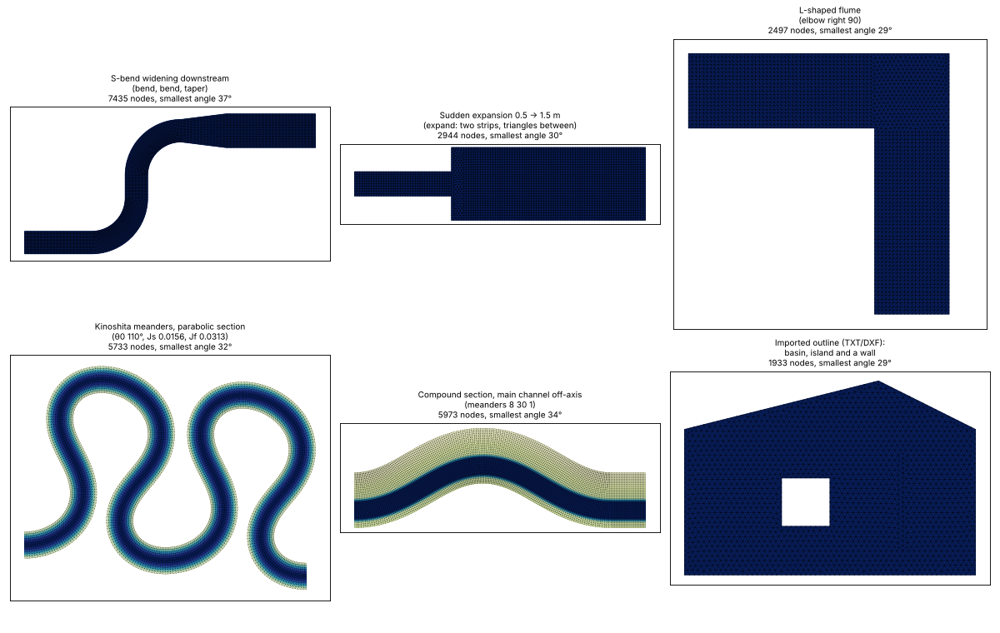
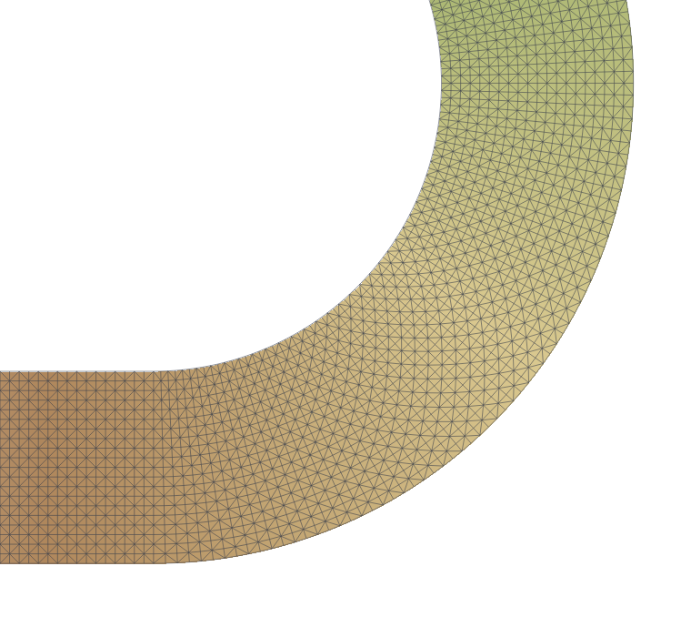

# 6. Plantillas de canal

Panel *Mesh workflow*, paso 1 → **Channel or flume template…** (o *Mesh → Channel or flume template* en el
menú y en la caja de herramientas). Dibuja un canal de laboratorio o un canal esquemático en el proyecto de
malla actual (o en uno nuevo en coordenadas locales), con su fondo definido por números en lugar de un MDE.

## Cuándo usarla y cuándo no

Úsala para:

- **experimentos en canal de laboratorio y sus réplicas numéricas** (canales rectos, curvos o con
  meandros);
- **comprobaciones contra soluciones analíticas**: tirante normal, curvas de remanso, sobreelevación en
  curvas;
- **pruebas de sensibilidad** al tamaño de malla, a la ley de fricción, al modelo de turbulencia o al paso de
  tiempo sobre una geometría limpia;
- **tramos idealizados** para docencia, transporte de sedimentos o estudios de hábitat.

Un **río natural** con topografía real no se dibuja con la plantilla: dibuja el dominio, las márgenes y el eje
del canal y las fronteras sobre el mapa, encima de un MDE ([flujo de trabajo de la malla](05-flujo-de-malla.md)).
Las ideas de la plantilla igual sirven ahí: un canal estructurado curvo sigue las márgenes que dibujes, y una
fórmula del fondo en coordenadas de canal puede excavar un canal idealizado en un tramo real
([editar una malla existente](07-editar-malla.md)).

## Plantas

| Planta | Parámetros | Uso típico |
| --- | --- | --- |
| **Straight** (recta) | longitud, ancho | canales de laboratorio, tirante normal, remanso |
| **Bend** (curva) | longitud del tramo recto de entrada, radio de la curva (en el eje), ángulo (90°, 180°, …), giro a la izquierda o a la derecha, longitud del tramo recto de salida, ancho | experimentos en canales curvos, flujo secundario, sobreelevación |
| **Meanders** (generados por seno) | longitud de onda a lo largo del eje λ, ángulo máximo de desviación θ₀, número de longitudes de onda, tramos rectos de entrada y salida, ancho | canales con meandros, secuencias de curvas |
| **Composed from segments** (compuesta por tramos) | un texto corto, un tramo por línea (más abajo) | cualquier canal: curvas en S, vueltas en U, formas en L, ampliaciones y contracciones, meandros de Kinoshita, escalones en el fondo |
| **Centreline from a line layer** (eje de una capa de líneas) | una línea dibujada, un ancho o un campo de ancho | una forma calcada de un plano o una foto de la instalación |
| **Imported file** (archivo importado) | un archivo TXT, CSV o DXF, leído como eje o como contorno | planos de laboratorio, tanques y estanques de cualquier forma |

La forma de los meandros es la curva generada por seno de Langbein y Leopold (1966): el rumbo del eje es
θ(s) = θ₀ sen(2π s / λ). Su curva más cerrada tiene radio λ / (2π θ₀); la herramienta rechaza las formas en
que ese radio es menor que la mitad del ancho (la margen interior se cruzaría consigo misma), y lo mismo
para una curva cuyo radio sea menor que la mitad del ancho.

Parámetros comunes: **origin** (centro de la entrada en las plantas curvas; (0, 0) por defecto),
**direction** en la entrada (grados, en sentido antihorario desde x), **element size** (tamaño de elemento),
malla **structured** (estructurada) activada o no y, opcionalmente, el **inflow** (caudal de entrada) y el
**outlet water level** (nivel del agua a la salida), que se escriben como valores de frontera.

## Canales compuestos

Elige *Composed from segments* y escribe el canal, un tramo por línea (o separados por `;`); `#` inicia un
comentario. El canal empieza en el origen con el rumbo del ángulo de dirección.

| Tramo | Significado |
| --- | --- |
| `width W` | ancho inicial (m); más adelante en el texto, un cambio brusco de ancho |
| `straight L` | tramo recto de longitud L a lo largo del eje |
| `bend left R A` / `bend right R A` | curva circular, radio R en el eje, ángulo A (grados) |
| `elbow left A` / `elbow right A` | esquina viva (sin radio), como en un canal en L |
| `meanders λ θ₀ N` | N meandros generados por seno, longitud de onda λ a lo largo del eje, desviación máxima θ₀ (grados) |
| `kinoshita λ θ₀ N Js Jf` | meandros de Kinoshita (curvas asimétricas y achatadas, como en muchos experimentos de meandros): θ(s) = θ₀ sen ks + θ₀³ (Js cos 3ks − Jf sen 3ks) |
| `taper W L` | ancho que cambia linealmente hasta W en un tramo recto L |
| `expand W` | ampliación o contracción brusca hasta el ancho W |
| `slope S` | pendiente del fondo desde aquí (positiva hacia aguas abajo) |
| `drop D` | un escalón en el fondo: baja D (negativo = sube) |
| `bed Z` | cota del fondo en el eje desde aquí |
| `section …` | la sección transversal desde aquí (tabla siguiente) |

Por ejemplo, un canal que se ensancha aguas abajo después de una curva en S:

```
straight 3
bend left 2 90
straight 1
bend right 2 90
taper 1.5 2
straight 4
```

Una ampliación brusca es `width 0.5`, `straight 2`, `expand 1.5`, `straight 4`; un escalón descendente en el
fondo es `straight 2`, `drop 0.05`, `straight 4`; un canal en L es `straight 3`, `elbow right 90`, `straight 3`.

Las partes del canal entre cambios bruscos de ancho y esquinas vivas son franjas estructuradas separadas: la
franja angosta de una ampliación llega hasta el escalón y la ancha empieza un poco después, dos franjas se
detienen antes de un codo, y triángulos llenan la esquina o el inicio de la ampliación (donde el flujo se
separa). En el resto la franja sigue al canal, y donde el ancho cambia (taper) el número de nodos a lo ancho lo
sigue. La herramienta rechaza curvas más cerradas que la mitad del ancho, y *Generate mesh* avisa de celdas
comprimidas en una margen interior (por ejemplo, curvas de Kinoshita muy cerradas).



## Secciones transversales

La sección se elige en la herramienta (vale para todas las plantas) o con líneas `section` en un canal
compuesto. `n` es la distancia al eje (positiva a la izquierda), `b` la mitad del ancho local; el **offset**
desplaza el cauce principal a la izquierda (+) o a la derecha (−) del eje, para un cauce pegado a una pared.

| Sección | Parámetros | Fondo sobre la cota del eje |
| --- | --- | --- |
| Rectangular | — | plano |
| Trapecial | ancho de plantilla, talud (H por 1 V), altura de márgenes, offset | sube en los lados hasta la altura de las márgenes |
| Compuesta | ancho del cauce principal, talud, altura de las planicies, pendiente transversal de las planicies, offset | un cauce principal y planicies a una altura, que pueden subir hacia los muros |
| En V | profundidad, offset | profundidad × \|n\| / b |
| Parabólica | profundidad, offset | profundidad × (n / b)² |
| Trapecio asimétrico | ancho de plantilla, talud izquierdo, talud derecho, altura de márgenes, offset | taludes distintos |
| Personalizada | una fórmula de `n` y `b` (y `s`) | p. ej. `0.1*(n/b)**4` |

En un canal compuesto: `section rect`, `section trapezoid 0.5 1 0.2`, `section compound 0.5 1 0.1 0.03 -0.3`,
`section v 0.1`, `section parabolic 0.08`, `section asym 0.4 1 2 0.2`, `section custom 0.1*(n/b)**4`. Una línea
`section` cambia la sección desde ese punto (con un escalón en el fondo donde difieren).

## Formas dibujadas e importadas

- **Eje de una capa de líneas**: dibuja el eje (en coordenadas locales para un canal de laboratorio, o sobre un
  mapa: un proyecto nuevo toma entonces el SRC de la capa), con un ancho constante o un campo numérico de ancho.
  Las esquinas más agudas que 30° (un ajuste avanzado) se vuelven codos; las curvas suaves siguen siendo una
  sola franja.
- **Archivo importado**:
  - TXT o CSV: dos o tres números por línea (x, y y, si se quiere, el ancho en ese vértice) separados por
    espacios, tabuladores, comas o punto y coma; una línea sin números (en blanco, un encabezado, `END`) inicia
    una polilínea nueva.
  - DXF: líneas, polilíneas y polilíneas cerradas (se ignora la Z).
  - Leído como **eje**: la línea más larga, con sus anchos cuando el archivo los da.
  - Leído como **contorno**: la línea cerrada más grande es el dominio (un estanque, un tanque, cualquier forma),
    las líneas cerradas dentro de él son islas y las líneas abiertas, líneas de quiebre (muros, escalones o bordes
    dibujados en el archivo). El fondo queda plano a la cota de entrada (con la pendiente a lo largo de x si se
    da una). Dibuja después las líneas de entrada y salida sobre el contorno (el trazado, **T**, lo sigue).

### Dibujar a mano un canal curvo o en forma de anillo

Las plantas de arriba construyen por ti el sector de anillo de una curva, los meandros y sus uniones. Para
dibujarlo tú:

- **Solo el eje** (recomendado): dibuja el eje en cualquier capa de líneas; para arcos verdaderos usa **Add
  Circular String by Radius** (barra Shape Digitizing). Luego *Centreline from a line layer* con el ancho: se
  generan ambas márgenes, el dominio, la franja estructurada y las líneas de entrada y salida. Los arcos se leen
  como polilíneas con un vértice cada grado.
- **El polígono del dominio**, con las herramientas de QGIS:
  - **Add Ring** (barra Advanced Digitizing) abre un hueco en un polígono: un círculo con otro círculo menor
    como anillo es una corona. Los huecos del dominio son islas, no se mallan.
  - **Split Features** corta la corona al ángulo deseado.
  - **Buffer** de Processing sobre un eje con *End cap style = Flat* da toda la franja del canal de una vez.
  - **Merge Selected Features** (o **Dissolve** de Processing) une las piezas en un solo dominio; **Check the
    drawing** encuentra luego las piezas que no llegan a tocarse (huecos angostos) y los vértices casi
    coincidentes.

## Qué agrega al proyecto

- el polígono del **dominio**;
- una línea de **entrada** (tipo Q) y una de **salida** (tipo H), que se detienen antes de las esquinas para
  que las esquinas sigan siendo paredes;
- con *Structured*: en un canal recto, una zona de malla estructurada; en una curva o en meandros, la
  **margen izquierda, la margen derecha y el eje** en la capa de canales, con un vértice por sección
  transversal, de modo que las celdas estructuradas son normales al eje aun en las curvas (más angostas en
  la margen interior y más anchas en la exterior);
- la **fórmula del fondo** y el **tamaño por defecto** en los ajustes del proyecto;
- en canales compuestos, dibujados e importados, y con las secciones nuevas: el eje completo (`flume_axis` en la
  capa de canales) y un perfil de anchos en los ajustes, para que la fórmula del fondo pueda usar `s`, `n` y `b`
  (la mitad del ancho local) donde el canal se angosta o se ensancha.



## El fondo

- **Bed level at the inlet** (cota del fondo a la entrada) z₀ y **slope** (pendiente) S a lo largo del eje
  (positiva hacia aguas abajo).
- **Sección transversal**: rectangular (fondo plano entre muros verticales) o trapecial (ancho de plantilla,
  talud como horizontal por 1 vertical, altura de las márgenes; márgenes planas por encima).

### Fórmulas del fondo en coordenadas de canal

Para un canal recto la fórmula se escribe en x e y. Para curvas y meandros se escribe en las **coordenadas de
canal**:

- `s`: distancia a lo largo del eje desde su inicio (m);
- `n`: distancia con signo desde el eje (m), positiva a la izquierda mirando aguas abajo;
- `b`: la mitad del ancho del canal en `s` (canales compuestos, dibujados e importados, que guardan un perfil de
  anchos).

Un canal trapecial de 0.6 m de ancho en la plantilla, talud 1:1, márgenes de 0.2 m de altura y pendiente
0.001:

```
0.30 - 0.001*s + clip((abs(n) - 0.3)/1, 0, 0.2)
```

La fórmula está en los ajustes del proyecto (el paso 3 la muestra) y se puede editar: agrega una secuencia de
pozas y rápidos (`+ 0.02*sin(2*pi*s/5)`), una pendiente transversal del fondo en las curvas, una fosa de
socavación, lo que se pueda escribir con NumPy. Cualquier proyecto de malla con una línea de eje en su capa
de canales puede usar `s` y `n`; cuando hay varios ejes, el ajuste `bottom_axis` indica el canal que se
usará.

## Ejemplo: la curva de 180°

`scripts/make_bend_demo.py` construye un canal de 1 m de ancho con una entrada de 3 m, una curva de 180° de
radio 2 m y una salida de 3 m, pendiente 0.001 a lo largo del eje, celdas de 5 cm, n de Manning = 0.025
escrita en el archivo de geometría y 0.05 m³/s. En TELEMAC-2D v9.1.1 el flujo es permanente después de
unos minutos; el caudal a través de cinco secciones es de 0.04999 a 0.05001 m³/s, y la superficie del agua
está 6.3 mm más alta en la margen exterior en el ápice, contra 6.0 mm según la estimación de Rozovskii
U²W/(gR) ([resumen de la corrida](../../tests/data/demo_bend/run_summary.txt)).

Ten en cuenta que TELEMAC numera la salida de este caso como frontera líquida 1 (empieza desde el punto de
la frontera con el menor x + y); el plugin numera las fronteras de la misma manera, así que su archivo `.liq`
y las líneas del archivo de configuración son correctos.

[← El flujo de trabajo de la malla](05-flujo-de-malla.md) · [Contenido](README.md) · [Siguiente: Editar una malla existente →](07-editar-malla.md)
