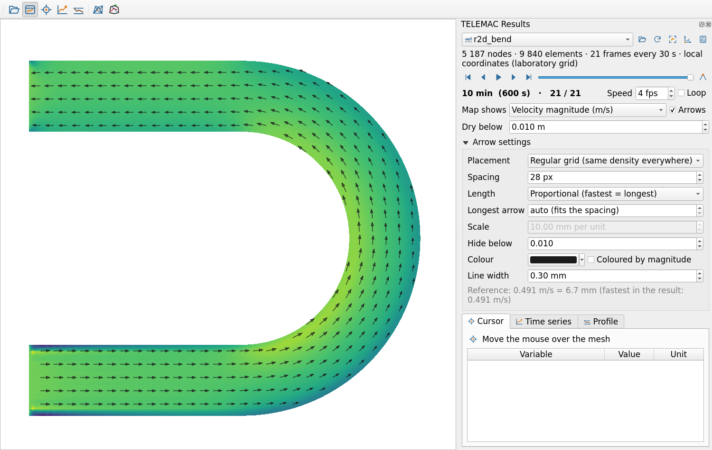

# TELEMAC Toolkit para QGIS: guía de usuario

[English](../guide/README.md) · **Español**

Versión 0.5.0 · QGIS 3.44 LTR y QGIS 4.x · Windows, Linux, macOS

TELEMAC Toolkit construye mallas y analiza resultados de TELEMAC dentro de QGIS, usando solamente QGIS y
Python. El generador de mallas está hecho primero para TELEMAC y escribe la misma malla para otros programas
2D (BASEMENT, TUFLOW FV, Iber, Delft3D FM, MIKE 21 FM, ADCIRC/SCHISM, HEC-RAS).

## Contenido

1. [Instalación](01-instalacion.md)
2. [Primeros pasos: un resultado en cinco minutos, un canal en diez](02-primeros-pasos.md)
3. [Ver resultados](03-resultados.md): abrir archivos, coordenadas, tiempo, flechas, cursor, series de tiempo, perfiles
4. [Calculadora, integrales y flujos](04-calculadora-integrales.md)
5. [El flujo de trabajo de la malla](05-flujo-de-malla.md): proyecto, dibujo, fondo, rugosidad, fronteras, mallado, calidad
6. [Plantillas de canal](06-plantillas-de-canal.md): recto, curva, meandros, fórmulas del fondo en s y n
7. [Editar una malla existente](07-editar-malla.md): batimetría, diques, dragado, fricción; editar nodos y elementos, re-mallar una zona
8. [Formatos, coordenadas y condiciones de frontera](08-formatos-coordenadas-fronteras.md)
9. [Referencia de las herramientas de Procesos](09-referencia-procesos.md) (cada herramienta y parámetro)
10. [Scripts con Python](10-python.md)
11. [Solución de problemas y preguntas frecuentes](11-solucion-de-problemas.md)
12. [Condiciones de frontera y archivos de corrida](12-archivos-de-corrida.md): curvas de descarga, hidrogramas, estado inicial, archivo de configuración, revisión

## Sobre los nombres que verás en pantalla

La interfaz del plugin está en inglés: sus botones, paneles, menús y parámetros se llaman igual que en esta
guía, escritos en *cursiva*, por ejemplo *Open TELEMAC result…* o *Map shows*. Se dejan en inglés para que
puedas encontrarlos tal cual en pantalla, y la guía explica en español qué hace cada uno. Los menús propios
de QGIS siguen el idioma de tu QGIS: en español, *Plugins* se llama *Complementos* y el administrador de
complementos es *Administrar e instalar complementos*.

## Qué está dónde

| Quieres | Usa |
| --- | --- |
| Abrir y animar un resultado de TELEMAC | Botón *Open TELEMAC result…* de la barra de herramientas, o arrastrar el `.slf` a QGIS; el panel **TELEMAC Results** |
| Leer valores, graficar series de tiempo, dibujar perfiles | Pestañas *Cursor*, *Time series* y *Profile* del panel de resultados |
| Calcular variables nuevas (Froude, esfuerzo cortante, vorticidad, máximos) | Panel de resultados → botón de la calculadora, o *Complementos → TELEMAC Toolkit → Calculator* |
| Caudal a través de una sección, volúmenes | *Complementos → TELEMAC Toolkit → Integrals and fluxes* |
| Construir una malla | Botón *Mesh workflow panel* de la barra de herramientas |
| Construir un canal de laboratorio, una curva o meandros | Panel *Mesh workflow*, paso 1 → *Channel or flume template* |
| Construir un río natural a partir de un eje, líneas de margen o un MDE | Panel *Mesh workflow*, paso 1 → *River reach…* |
| Cambiar el fondo (o la fricción) de una malla existente | *Complementos → TELEMAC Toolkit → Mesh → Edit node values of a mesh* |
| Refinar donde el terreno se quiebra; líneas de quiebre desde un MDE; adaptar una malla con MMG | Panel *Mesh workflow*, paso 1 *Terrain tolerance*, paso 2 *Breaklines from the DEM…*, paso 5 *Optimise or adapt (MMG)…* |
| Comparar métodos de mallado (y mallas de Blue Kenue) | Panel *Mesh workflow*, paso 4 → *Compare methods…* |
| Mover, agregar o borrar nodos; re-mallar una zona | Panel *Mesh workflow*, paso 5 → *Edit in QGIS*, *Re-mesh inside polygons…* |
| Convertir una malla a otro programa | *Mesh → Export or convert mesh* |
| Ejecutar algo por lotes o dentro de un modelo | Caja de herramientas de Procesos → **TELEMAC Toolkit** |

## Palabras que se usan en esta guía

- **Resultado**: un archivo SELAFIN (`.slf`, `.res`) escrito por TELEMAC, con uno o más pasos de tiempo
  (cuadros, *frames*).
- **Archivo de geometría**: el archivo SELAFIN que TELEMAC lee como malla, con la variable `BOTTOM` y,
  posiblemente, `BOTTOM FRICTION`.
- **Proyecto de malla**: un GeoPackage creado por el plugin, con una capa por cada tipo de objeto que
  dibujas (dominio, zonas de refinamiento, canales, fronteras…) y los ajustes del mallado.
- **Coordenadas locales**: una cuadrícula métrica con (0, 0) en el origen y sin lugar en la Tierra, para
  canales de laboratorio y canales esquemáticos.
- **Coordenadas de canal s y n**: distancia a lo largo del eje de un canal (s) y a través de él (n,
  positiva a la izquierda mirando aguas abajo).
