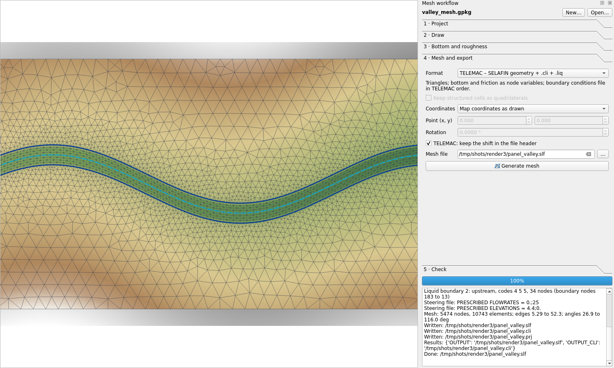
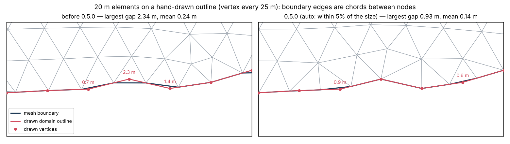
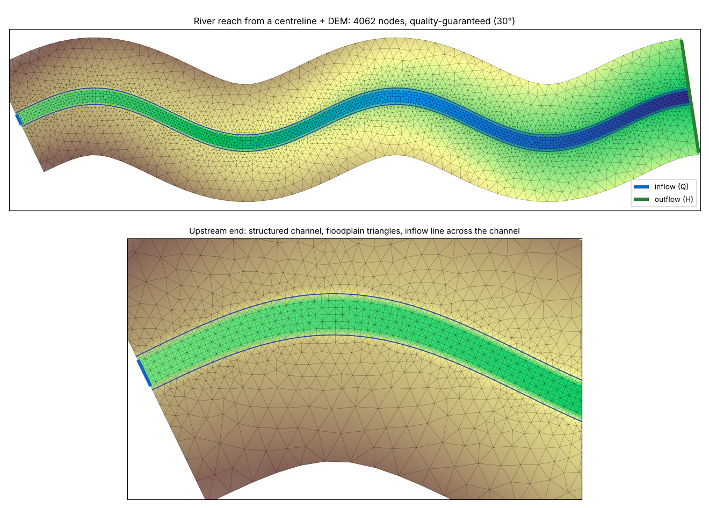
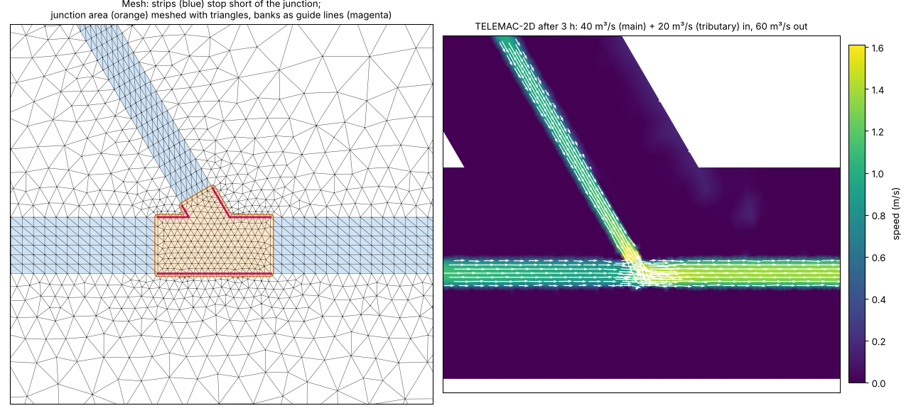

# 5. The mesh workflow

Toolbar → **Mesh workflow panel**. The panel has six steps. Each step runs a Processing tool, so the same
work can be done from the toolbox, a model or a script ([reference](09-processing-reference.md)).

## Step 1 · Project

- **New…** creates a *mesh project*: a GeoPackage with one empty, styled layer per kind of object, added to
  the map in a group, plus a settings table. Answer **Yes** for **local coordinates** (a laboratory flume
  or a schematic channel drawn from (0, 0)); **No** to choose a map CRS. Use a projected CRS in metres,
  never a geographic one: sizes would be in degrees.
- **Open…** opens an existing project (projects from 0.2.0 included). When a project's layers are already
  on the map, the panel finds them by itself.
- **Coordinates** shows the project CRS ("local (laboratory)" or an EPSG code). A CRS without an EPSG code — often
  one read from a DEM's own definition, such as INEGI's ITRF92 UTM — makes QGIS list the project's layers with
  an empty `[ ]` in tool dialogs (where it normally shows `[EPSG:32614]`). The coordinates are still right.
  When the CRS has the same projection as an EPSG one (WGS 84, NAD83, Mexico ITRF92 or ITRF2008 UTM, Mexico
  ITRF2008 LCC), *New…* offers that code, and opening an existing project offers to give it that code; the
  coordinates do not change.
- **Default size**: element size where no refinement applies, in metres. *auto* uses about 1/40 of the
  square root of the domain area (0.1 m for a 20 m × 1 m flume, 25 m for a 2 km² valley) and says so in
  the log. The sizes are in the units of the map (metres for a UTM project). A size of 0.2 or 0.05 on a
  domain tens of kilometres wide asks for billions of nodes: *Generate mesh* estimates the number of nodes
  first and stops at once, with a message, above the **Node limit** (2 million by default; raise it for a
  large model, 0 removes the check). The mesher needs about 1.5 s per 10 000 nodes on a laptop, so 700 000
  nodes (a 100 km reach, 5 km wide, at 25 m) take about 2 minutes.
- **Growth rate**: how fast the size grows away from refined areas (1.2 = 20 % per element). Lower is
  smoother and has more elements.
- **Smoothing**: iterations that move interior nodes to improve angles (8 is a good default).
- **Follow the outline within** (*auto* = 5 % of the element size): how far the mesh boundary may stray
  from the drawn outline, islands and guide lines. Their nodes are placed along the drawing at the element
  size, so a mesh edge is a straight chord between two points of the drawing: where the drawing bends between
  them, the edge cuts across the bend, inside on a convex bend and outside on a concave one. Corners (turning
  more than 30° at the scale of an element) always stay nodes; any other drawn vertex stays a node too when
  leaving it out would move the boundary more than this distance. The log gives the largest distance left
  (*Largest distance between the drawn lines and the mesh edges*). Set a distance in metres for a closer fit
  (0.01 m keeps practically every vertex). Details smaller than half an element — the zigzags of fast
  digitizing — are not followed, so they do not create slivers; the log counts them. Breaklines always keep
  every vertex.

  
- **Method**: *Balanced* places nodes on regular patterns and smooths them (fast, smooth size changes).
  *Quality-guaranteed* then refines until every triangle reaches the **Smallest angle** (20 to 30°):
  triangles below it get a node at their circumcentre, or split the constraint segment that node would
  crowd. It adds few nodes (7 to 10 on meshes of 4 000 to 5 000 nodes in the tests) and skips the final
  smoothing, which would undo the guarantee. Two kinds of triangles can stay below the target, and the log
  counts them: those with an edge on a structured channel or grid (those edges are fixed), and those next to
  a corner of the drawing sharper than the target (a 15° corner cannot give 30° triangles). Above 30° the
  refinement does not converge, so the panel stops there.
  The **Gmsh** methods (*Delaunay*, *Frontal-Delaunay*, *MeshAdapt*, *quadrilaterals*) need the optional gmsh
  package ([install](01-install.md#optional-gmsh)). The plugin still prepares everything around the inside —
  outline and islands resampled to the size field, breaklines and their crossings, fixed points, structured
  channels and grids — and Gmsh fills the inside with its algorithm, following the same size field, without
  adding nodes on any of those lines. Stitching, bottom, boundary conditions and output formats are the same
  for every method. *Gmsh quadrilaterals* keeps its quadrilaterals for the formats that accept them; TELEMAC
  gets each one as two triangles, cut along the diagonal that gives the better angles. See
  [Comparing meshing methods](#comparing-meshing-methods) below for how they differ on a real case.
- **Terrain tolerance** (off by default) and **Terrain smallest size**: terrain-driven sizes from the first
  DEM ticked in step 3 — see [Terrain-driven meshing](#terrain-driven-meshing).
- **Suggest sizes from the DEM…** — see [Sizes from the DEM](#sizes-from-the-dem) below.
- **Channel or flume template…** draws a flume, a bend or meanders with their bed formula — see
  [Channel and flume templates](06-channel-templates.md).
- **River reach…** draws a natural river, or a network of rivers with confluences — see
  [Natural rivers](#natural-rivers-the-river-reach-helper) below.

## Natural rivers: the river reach helper

The helper turns a centreline or two bank lines into a river ready for *Generate mesh*; several centrelines
that join make a river network (see [River networks](#river-networks-confluences-and-bifurcations)).

| Given | The banks |
| --- | --- |
| Centreline and a **constant width** | Half the width on each side, on cross-sections normal to the smoothed centreline. |
| Centreline and a **DEM** | At every cross-section the terrain across the river is read, the bed is found near the centreline, and each bank goes where the terrain first rises the **bankfull depth** above the bed (searched up to the **largest width**). The widths are smoothed along the river and the axis is moved midway between the banks. |
| **Two bank lines** | One line layer with both banks, in any order and direction. Cross-sections are normal to their smoothed middle line and cut by both banks, so the banks keep their drawn shape. |

It writes into the project:

- **Structured channel**: left bank, right bank and axis with one vertex per cross-section, so the strip's
  cells are normal to the flow, in bends too. With *Nodes across follow the width* (the default) the number
  of nodes across changes along the river so they stay about one cross-section spacing apart: where the
  river widens or narrows, one row of triangles adds or removes a node on each side of the axis, at most
  every second row, and the other rows stay cells. It never goes below 7 nodes across, so an inflow has at
  least 5 liquid nodes: with fewer, the discharge enters as a jet through half the channel, can turn
  supercritical and dry the boundary (TELEMAC stops with *DEBIMP*). Give *Nodes across* a value to keep it
  constant (an odd number, for the axis).
- **Domain**: the river plus the **floodplain width** on each side, with straight ends normal to the axis.
  With *Keep the domain of the project* your own domain is used and the reach is cut to the cross-sections
  inside it.
- **Boundary lines**: inflow (Q) across the channel at the upstream end, outflow (H) across the whole
  downstream end of the domain, so water on the floodplain can leave. Either can cover the channel only or
  the whole end. The lines stop short of their ends, so the bank and corner nodes stay walls. Discharge and
  level are optional; set them later in the boundaries layer or the `.liq` file.
- **Default size**, if the project has none: the floodplain element size, or four times the cross-section
  spacing.

**Direction**: with a DEM the river is turned to run downstream, from the higher bed to the lower one, and
the log says so. Without a DEM, draw the centreline downstream.

**Jagged lines and tight bends**: the centreline is smoothed over the *smoothing length* (default: the
width) before the cross-sections are taken. In a bend tighter than half the width, neighbouring
cross-sections would cross on the inner bank, or leave inner-bank cells far shorter than they are wide.
Only the cross-sections there are turned (blended into smoothed directions over a few smoothing lengths),
until none cross and no inner-bank cell is shorter than the spacing divided by the *ratio* (advanced
parameter, default 4); everywhere else the cross-sections stay normal to the flow. Any that still cross are
reported with their distance along the river: edit the banks there, or use a larger spacing.

**Choosing the values**:

- *Cross-section spacing*: the element length along the river, usually a fifth to a tenth of the width
  (5–8 m for a 40 m river).
- *Floodplain width*: up to the edge of the largest flood you will model.
- *Bankfull depth*: the bank height above the bed; check the widths the log reports (smallest, largest,
  median) against the map.

After the helper: tick the DEM in step 3 and run *Generate mesh* in step 4.

### River networks: confluences and bifurcations

Give several centrelines in the centreline layer: each tributary ending on the river it joins (it may stop a
little short or overshoot — up to a quarter of the largest width, at least one spacing), or lines meeting end
to end where a river splits. Lines must run downstream; with a DEM each line is turned on its own. An
optional **width field** gives each line its own constant width (empty values take the width parameter, or
the DEM).

The helper then writes:

- **One structured channel per reach** between junctions and free ends (`river_1`, `river_2`, …). Each strip
  stops short of its junctions: past the last cross-section that still touches another channel, plus a
  quarter of its width.
- **The junction**: a *refinement area* over the channel area left between the strip ends, with the size of
  the finest strip spacing there, and its **banks as guide lines**. Going round the junction each bank is
  followed until it meets the bank of the next branch, so the confluence keeps its corners; where two
  banks never meet (the straight side of a main river) they are joined across.
- **Domain**: every reach widened by the floodplain, round at the junctions and straight at the free ends.
- **Boundary lines**: an inflow (Q) at every free upstream end, an outflow (H) at every free downstream end.
  A discharge given in the tool goes to the inflow only when there is one; with several, set each in the
  boundaries layer.

Tested on a 60° confluence (main river 40 m wide, tributary 25 m): 5 300 nodes, smallest angle 27°, and
in TELEMAC-2D 40 m³/s and 20 m³/s in, 60 m³/s out through the rating curve.

**Initial conditions for a network**: a level along the main river's axis leaves a tributary's inflow dry
(TELEMAC stops with *DEBIMP: problem on boundary number n*). Use the initial conditions tool's *Depth above
the bed of the channel axes* with the project's channels layer: every node takes the bed of the nearest axis
plus the depth, so every branch starts with water. The steering file tool warns when a discharge boundary
starts dry.

**Limits**:

- A network makes its own domain (not *Keep the domain of the project*), from centrelines (not bank lines).
- Two junctions closer than a few widths leave no room for a strip between them: the tool says which reach
  is too short. Use a smaller spacing or one junction.
- The DEM must show the channel. A LiDAR DEM without bathymetry shows the water surface, not the bed: the
  banks are still found, but the bed must come from survey points or a formula in step 3.

### Sizes from the DEM

*Suggest sizes from the DEM…* (step 1, or the *Suggest element sizes from a DEM* tool) reads the DEM ticked in
step 3 (or the only DEM on the map), the domain and the structured channels, and suggests:

| Size | Rule |
| --- | --- |
| Smallest size | Two pixels: a finer element only interpolates the same pixels, it adds nodes but no terrain. |
| Terrain tolerance | About the vertical accuracy of a DEM with such pixels: 0.05 m for 1 m LiDAR, 0.1 m for 2 m, 0.2 m for 5 m, 0.5 m for 15 m (INEGI). |
| Default size (floodplain) | What the median terrain inside the domain asks for at that tolerance; at least four pixels, at most a twentieth of the domain, and coarse enough that the default size alone stays within half the node budget. |
| Rivers | Spacing across of an eighth of the width (7 nodes or more across), along 1.5 times that. A river narrower than 8 pixels cannot be shown by the DEM: the tool says so, and the bed should come from survey points or a formula. |
| Nodes and time step | The node count with the terrain refinement (the tolerance is relaxed if it is over the budget, 300 000 by default) and the time step at Courant number 1 on the smallest elements. |

**Apply** puts the default size, terrain tolerance and smallest size into step 1. When you tick a DEM in step 3
and the project has no default size yet, the suggestion is written to the log at once.

On the 2 km test valley (2 m DEM): smallest size 4 m, tolerance 0.1 m, rivers about 48 m wide → 6 m across and
8 m along.

## Step 2 · Draw

The table lists the project layers and how many objects each has. Select a layer and **Draw in this
layer** (or use QGIS's own editing tools: snapping, tracing, copying from other layers all work).

| Layer | What it is for | Fields |
| --- | --- | --- |
| **Domain (holes are islands)** | Area to mesh. Holes in a polygon are left out. Several polygons are meshed together. | `name`, `size` (optional) |
| **Islands (not meshed)** | Areas left out: buildings, piers, dry islands | `name` |
| **Refinement areas** | Finer (or coarser) elements inside | `size` (m) |
| **Refinement points** | Element size at a point: structures, gauges | `size` |
| **Constraint lines** | Lines the mesh follows. `mode` = **breakline** (every vertex kept: dikes, road crests, banks, walls) or **guide** (resampled to the local size: thalwegs, contours). Empty mode = breakline. | `name`, `mode`, `size` (optional) |
| **Fixed points** | Nodes that must exist: gauges, outfalls, structure corners | `name`, `size` (optional) |
| **Structured channels** | A channel meshed as a structured strip: one **left** and one **right** bank line and an optional **axis**, told apart by `role`, grouped by `channel` | `channel`, `role`, `nodes_across`, `spacing`, `across_spacing` (optional) |
| **Structured grid zones** | Rectangles (any orientation) meshed as regular grids | `name`, `dx`, `dy` |
| **Roughness zones** | Material id per element and friction value per node; later zones win where they overlap | `name`, `material`, `friction` |
| **Boundary conditions** | Lines along the domain edge with a boundary type | `name`, `type`, `value`, `tracer`, `codes` |

Tips:

- **Snapping** is set when a project opens (untick *Set snapping, tracing and hover tips when a project
  opens* to keep your own): snapping to the vertices and edges of the domain, islands, channels, lines and
  boundary layers within 12 pixels, at intersections and on the feature being drawn, with topological editing;
  **tracing** on (press **T** while drawing to follow the outline, so a boundary line runs exactly along it);
  the **Advanced Digitizing** panel open (exact lengths, angles and coordinates); and **hover tips**. The
  *Snapping for this project* button sets it again.
- **Hover tips**: rest the mouse on an object to see what it is and its measures — a domain's element size,
  area, perimeter and about how many nodes it will take at that size; a refinement area's size and nodes; a
  line's mode and length; a channel's nodes across and cross-section spacing; a boundary's type with its
  TELEMAC codes, value and tracer.
- **Attribute forms**: fields have plain names and drop-down lists where they take a few values (constraint
  mode, channel role, boundary type and tracer).
- **Structured channels**: banks run in the same direction (the plugin reverses one if needed);
  `nodes_across` with an axis must be odd; `spacing` is the distance between cross-sections. When the
  left bank, right bank and axis have the **same number of vertices and each vertex k forms a
  cross-section**, the strip uses those cross-sections as drawn (normal to the axis in bends); otherwise
  each bank is spaced by its own length.
- **Boundary types**, the same list as Blue Kenue's boundary editor (LIHBOR LIUBOR LIVBOR):

  | Boundary code | `type` | Codes |
  | --- | --- | --- |
  | Closed boundary (wall) | `wall` | 2 2 2 |
  | Open boundary with prescribed Q | `Q` | 4 5 5 |
  | Open boundary with prescribed H | `H` | 5 4 4 |
  | Open boundary with prescribed Q and H | `QH` | 5 5 5 |
  | Open boundary with prescribed UV | `UV` | 4 6 6 |
  | Open boundary with prescribed UV and H | `UVH` | 5 6 6 |
  | Open boundary with incident waves | `waves` | 1 1 1 |
  | Open boundary, free (Thompson) | `free` | 4 4 4 |
  | Custom | `custom`, codes in `codes` (e.g. `5 4 4` or `5 4 4 4`) | as given |

  **Tracer code** (LITBOR), also as in Blue Kenue: *closed boundary (wall)* 2, *open boundary with prescribed
  tracer* 5, *open boundary with free tracer* 4. Empty follows the boundary type: inflows (prescribed Q or
  UV) 5, other open boundaries 4, walls 2. TELEMAC reads it only when the model has tracers. The per-node
  values Blue Kenue lists (HBOR, UBOR, VBOR…) stay 0 in the `.cli`: discharges and levels go in the steering
  file and the `.liq` file, which take precedence.
  The boundary line only has to run along the edge; every boundary node within half an edge length takes its
  type. Stop lines a little short of corners so the corner nodes stay walls.
- **Check the drawing** reports what the mesher will see — domains, islands, structured parts, lines,
  problems — before meshing. It warns about a boundary line lying more than a quarter of the default size
  away from the outline (its nodes would stay walls), and about a channel with one bank reaching the
  outline at an end while the other stops short of it.

  It also checks the geometry against the element size wanted at each place — what QGIS does not flag but
  the mesher pays for:

  | Problem | Found when | Safe fix |
  |---|---|---|
  | Near-duplicate vertices | closer than 1 % of the element size | removed |
  | Spike | the line turns back on itself (more than 170°) next to a short edge | vertex removed |
  | Very sharp corner | the same, with long edges | — (thin triangles there) |
  | Close corners | two corners of an outline or island (as the mesher sees them, at the scale of an element) closer than a quarter of the size | — |
  | Dense breakline | breakline vertices closer than a tenth of the size (every breakline vertex is a node) | — |
  | Narrow part or gap | the outline within half an element of itself, or an island within half an element of the outline or of another island (slivers) | — |
  | Line end just off the outline | a line end or grid-zone corner closer than a quarter of the size to the outline, but not on it | snapped onto it |
  | Invalid polygon | a self-intersection (bow-tie) or a ring crossing another | repaired (*makeValid*; a bow-tie becomes two features) |
  | Island crossing the outline, overlapping domains | — | — |

  Each problem is a point in a **Drawing check** layer at the top of the layer list (orange: can be fixed
  safely; red: to look at; hover for the message), and the first ones are listed in the log. **Fix the safe
  problems** makes the safe fixes in the layers' edit buffers — review them, then save the layers (or undo) —
  and checks again. The others are the modeller's call: move the island, merge the corners, make the
  breakline a guide line, or set a smaller size there. The same checks are in the toolbox as **Check the
  drawing of a mesh project** (optionally making and saving the safe fixes).

## Step 3 · Bottom and roughness

- **Rasters**: tick the DEMs to use and drag to set their priority; the first raster that covers a node
  gives its value (bilinear). Rasters in another CRS are sampled after transforming the nodes.
- **Survey points**: a point layer and its value field (or the point Z), interpolated linearly on their
  triangulation.
- **Formula**: the bottom as a formula of `x` and `y` (`0.3 - 0.002*x`), or of the channel coordinates
  `s` and `n` along a channel axis ([templates](06-channel-templates.md#bed-formulas-in-channel-coordinates)).
  Used where no raster or point covers a node.
- Nodes nothing covers take the value of the nearest node that has one (and the log says how many).
- **Default friction**: friction value outside the roughness zones. With roughness zones, TELEMAC files
  get a `BOTTOM FRICTION` variable, which TELEMAC-2D reads from the geometry file (the listing says
  `FONSTR : FRICTION COEFFICIENTS READ IN THE GEOMETRY FILE`) and uses instead of the steering-file value;
  set `LAW OF BOTTOM FRICTION` to match your values (4 = Manning). Other formats get a material id per
  element.

## Step 4 · Mesh and export

- **Mesh type**:
  - *Triangles*: unstructured triangles. Structured channels and grid zones drawn in step 2 are still built
    cell by cell, and written as two triangles per cell.
  - *Rectangles where drawn*: the structured channels (two bank lines) and grid zones (any four-sided area,
    cells `dx` × `dy`) keep their rectangular cells in the formats that accept them; triangles elsewhere.
    For a mesh of rectangles only, draw one grid zone over the whole (four-sided) domain, or use the channel
    template with *Structured mesh over the channel*.
  - *Quadrilaterals everywhere (Gmsh)*: Gmsh fills the inside with quadrilaterals (optional gmsh package).

  The choice sets the **Method** (step 1) and **Keep structured cells as quadrilaterals** below; changing those
  changes it back. **TELEMAC-2D computes on triangles only**: in a SELAFIN file every rectangle is split in two
  along its shorter diagonal; the rectangles stay in 2DM (BASEMENT, TUFLOW FV), Gmsh, GiD (Iber) and UGRID
  (Delft3D FM).
- **Format**: TELEMAC (SELAFIN + `.cli`) or another program — see
  [Formats](08-formats-coordinates-boundaries.md#formats).
- **Keep structured cells as quadrilaterals**, for formats that accept them.
- **TELEMAC: double precision (SERAFIND)**: coordinates and values in 8-byte floats. Not needed for accuracy —
  single precision with the origin in the header already places nodes within 0.01 mm — but some workflows ask
  for it. The files are twice as large; the steering file tool (step 6) then writes `GEOMETRY FILE FORMAT`,
  `RESULTS FILE FORMAT` (and `PREVIOUS COMPUTATION FILE FORMAT`) = `'SERAFIND'`, and the initial state is
  written in the same precision. Tested in TELEMAC-2D v9.1; QGIS reads SERAFIND files.
- **Coordinates**: map coordinates as drawn; lower-left corner at (0, 0); or a chosen point at (0, 0),
  with an optional rotation. For TELEMAC, *keep the shift in the file header* lets TELEMAC compute near
  (0, 0) while QGIS still shows the mesh in place.
- **Mesh file**, then **Generate mesh**. The log reports the mesh (nodes, elements, smallest angle),
  where the bottom came from, each liquid boundary with **the number TELEMAC will give it**, and the
  steering-file lines (`PRESCRIBED FLOWRATES`, `PRESCRIBED ELEVATIONS`). For TELEMAC the panel also
  writes a `.liq` template next to the mesh, with one column per prescribed value (`Q(1)`, `SL(2)`…) in
  TELEMAC's numbering: replace its values with your hydrographs.

How the mesh is built: the domain is filled with triangles whose size follows the refinement objects and
grows at the growth rate; breaklines keep their vertices, guide lines are resampled, crossings become
nodes; QGIS's GEOS library makes the Delaunay triangulation and missing constraint segments are split
until they are edges; oversized triangles get a node at their circumcentre; interior nodes are smoothed
without inverting any element; structured channels and grids are stitched in node for node; triangles
with three boundary nodes are fixed by an edge flip, unless the flip would make the worst angle worse. With
*Quality-guaranteed*, refinement rounds follow (see *Method* above). A 30 000-node mesh takes about 8
seconds.

**Checks on structured channels**, in the log before meshing:

- each channel's nodes across, its cells' length along over width across (smallest and largest) and how far
  its cross-sections are from normal to the banks; a warning when cells on an inner bank are less than a
  quarter as long as they are wide, more than six times longer along than across, or skewed more than 35°;
- **size jumps**: strip edges more than 2.5 times the element size asked for next to them (a refinement area
  finer than the strip beside it), where the triangles would be stretched;
- **strip ends on the outline**: an end cross-section on the domain outline with no boundary line over it (a
  closed end), or with a line covering only part of it (its nodes beside the banks stay walls).

## Comparing meshing methods

Step 4 → **Compare methods…** (*Mesh → Compare meshing methods*) meshes the project with each method you tick
and measures every result on equal terms. You can add mesh files made elsewhere — a Blue Kenue `.t3s`, a
SELAFIN or 2DM from Salomé, an earlier run — and they are measured the same way. The output is a table layer
and an HTML report that marks the best value of each row.

| Group | Measures |
| --- | --- |
| Element shape | smallest angle, 5th percentile of the smallest angles, share of elements below 30° and 20°, largest angle, aspect ratio (circumradius over twice the inradius: 1 for an equilateral triangle), edge lengths |
| Size changes | area ratio of the two elements on each side of an edge (1 = equal neighbours); sudden jumps cost accuracy |
| Outline | distance from the drawn domain to the mesh boundary |
| Terrain (with a DEM) | how far TELEMAC's linear bed inside each element is from the DEM, at seven points per element (RMS, 95th percentile, largest); with a water level, the error in the water volume under it |
| Time step | the largest stable step at a Courant number of 1 for the level (or depth) and velocity you give, set by the smallest elements in deep, fast water |
| Size | nodes, elements, nodes per km², meshing time |

No single score is given: a finer mesh follows the DEM better and needs a smaller time step, and only the
modeller can weigh that.

**Example**: the 2 km meandering river of the river-helper example (structured channel with 8 m
cross-sections, 30 m floodplain elements, DEM at 2 m, water level 6 m, velocity 1.5 m/s), on QGIS 4.0 with
Gmsh 4.15:

| Measure | Balanced | Quality-guaranteed | Gmsh Delaunay | Gmsh Frontal-Delaunay | Gmsh MeshAdapt | Gmsh quadrilaterals |
| --- | --- | --- | --- | --- | --- | --- |
| Nodes | 4 054 | 4 057 | 4 593 | 4 515 | 4 491 | 4 182 |
| Meshing time (s) | 2.7 | 3.0 | 1.2 | 1.4 | 2.1 | 1.2 |
| Smallest angle (°) | 25.2 | 29.4 | 31.8 | **35.3** | 28.5 | 15.2 |
| Angle, 5th percentile (°) | 40.4 | 40.2 | 42.0 | **42.8** | 40.7 | 35.8 |
| Aspect ratio, largest | 1.83 | 1.85 | 1.62 | **1.54** | 1.66 | 2.22 |
| Neighbour area ratio, 95th percentile | 1.52 | 1.52 | 1.55 | **1.48** | 1.50 | 1.63 |
| Bed error vs DEM, RMS (m) | 0.125 | 0.125 | **0.117** | 0.117 | 0.118 | 0.123 |
| Water volume error (%) | **−3.90** | **−3.90** | −3.94 | −3.94 | −3.94 | −3.90 |
| Time step at Courant 1 (s) | 0.80 | 0.80 | 0.80 | 0.80 | 0.80 | 0.80 |

What it shows: Gmsh's Frontal-Delaunay gives the best element shapes and the smoothest size changes, and
Gmsh is about twice as fast here. From the same size field Gmsh places about 11 % more nodes than the
built-in methods, which is also why its bed error is slightly smaller. The time step is the same for every
method, because the structured channel — identical in all of them — has the smallest elements in the deepest
water. The bed error is dominated by the channel banks, where a 3 m bank lies inside 8 m elements: refining
there (or a breakline on the bank tops) helps more than changing the method. All six meshes have one boundary
loop, no edge shared by more than two elements, and the same liquid boundaries. Meshes from the built-in
methods and Gmsh's Frontal-Delaunay have run in TELEMAC-2D v9.1 with this river.

## Terrain-driven meshing

TELEMAC carries the bed at the nodes and interpolates it linearly inside each element. Over an element of size
h, a terrain that bends with curvature κ is missed by about h² κ / 8. For a vertical tolerance (the **Terrain
tolerance**, for example 5 cm) the element size is therefore h = √(8 · tolerance / κ): small on banks, levees
and embankments, the default size on flat ground, never below the **Terrain smallest size** and never growing
faster than the growth rate. Next to structured channels and grids the sizes are held to the length of their
edges, so small terrain elements do not meet long fixed edges and make thin triangles.

Three tools go with it (*Mesh* group of the toolbox):

- **Element sizes from terrain (raster)** writes those sizes as a raster, to see where the refinement will go
  before meshing.
- **Breaklines from a DEM** draws lines along the sharp bends of the terrain for the mesh to follow: crests
  (levee and bank tops, embankments) and toes (bank feet, channel edges), where an element of the default size
  would miss the bend by more than the tolerance. With a mesh project the lines are clipped to the domain, kept
  half an element inside the outline and out of structured channels (which already follow their banks), and
  can be added to the constraint lines as guide lines or breaklines. Each added line gets an element size no
  larger than its distance to the nearest other line, so the elements between a bank top and its foot are not
  squeezed.
- **Optimise or adapt a mesh (MMG)** changes an existing TELEMAC mesh with MMG ([install](01-install.md#optional-mmg)):
  *optimise* (better shapes, the same sizes), *adapt to the terrain* (the sizes above), or *adapt to a TELEMAC
  result* (sizes from the curvature of a variable of a result on this mesh — free surface, velocity, depth —
  with a tolerance in its unit, for a second run with elements where the flow needs them). The boundary nodes
  do not move, so the boundary conditions carry over; elements inside the *keep* polygons (structured channels,
  bridges) stay as they are; every variable is carried over and, with a DEM, the bottom is sampled from it.

**Example** (the 2 km river, default size 30 m, smallest terrain size 2 m, built-in *Balanced* method):

| | Nodes | Bed error RMS | Largest bed error | Smallest angle | Time step at Courant 1 |
| --- | --- | --- | --- | --- | --- |
| Without terrain refinement | 4 052 | 0.137 m | 0.54 m | 27.2° | 0.80 s |
| Terrain tolerance 0.10 m | 7 133 | 0.103 m | 0.52 m | 25.8° | 0.80 s |
| Terrain tolerance 0.05 m | 7 600 | 0.100 m | 0.52 m | 27.2° | 0.80 s |
| MMG, adapted to the terrain (0.05 m) | 10 451 | 0.084 m | 0.52 m | 21.0° | 0.53 s |

The floodplain follows the terrain better, but the largest error does not move: it is inside the structured
channel, whose cells (8 m along, 7 m across) span the 3 m banks, and terrain sizes do not change a structured
part. On a river the channel's own resolution — the river helper's cross-section spacing and nodes across —
matters most. The MMG run here refined next to the kept channel without the size floor, which is why its time
step is smaller; the tool applies the floor next to *keep* polygons.

## Step 5 · Check

- **Mesh quality layer**: one polygon per element with its area, smallest and largest angle, longest edge,
  and a flag for angles below 20° or above 130° and for elements with all their nodes on the boundary
  (they block the flow in corners). The log gives the statistics.
- **Find** a node or an element by its number, as TELEMAC listings print them: the map zooms to it and the
  log gives its coordinates (and bottom for nodes).
- **Edit the generated mesh**: *Edit in QGIS (Mesh Digitizing)* and *Rebuild after editing*, *Re-mesh inside
  polygons…*, *Boundary lines from the .cli* — see [Changing the mesh itself](07-edit-existing-mesh.md#changing-the-mesh-itself).

## Step 6 · Run files

Rating curve for the outflow, hydrographs from a table, initial state, steering file and a check of the
boundary conditions, for the generated TELEMAC mesh — see [Boundary conditions and run files](12-run-files.md).

[← Calculator](04-calculator-integrals.md) · [Contents](README.md) · [Next: Channel and flume templates →](06-channel-templates.md)
