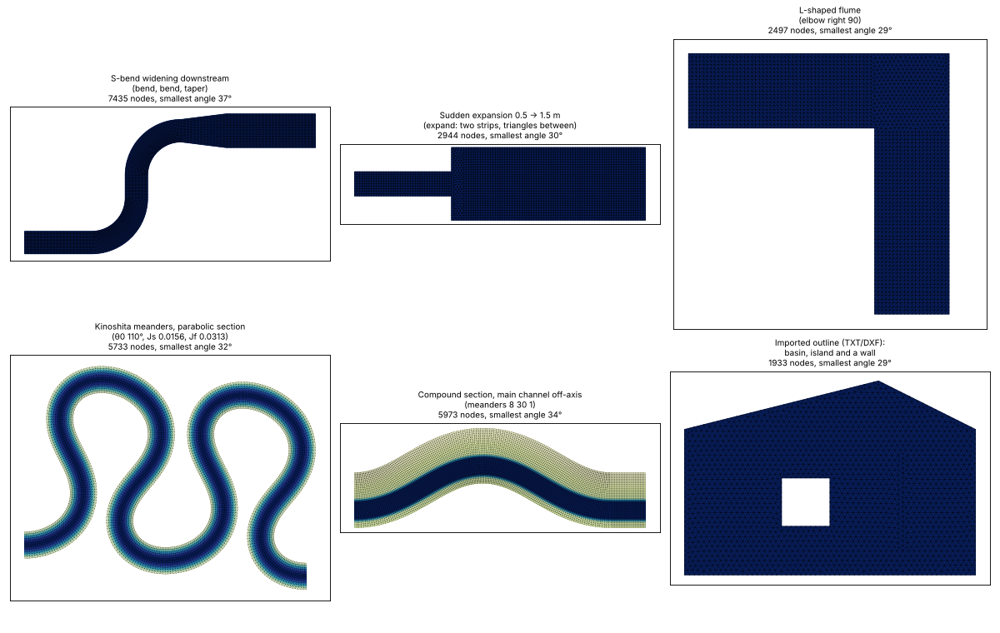
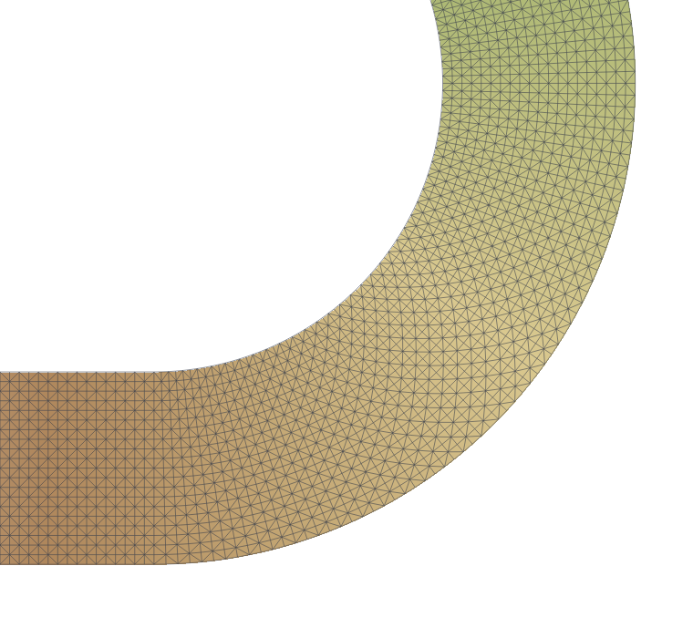

# 6. Channel and flume templates

Mesh workflow panel, step 1 → **Channel or flume template…** (or *Mesh → Channel or flume template* in the
menu and the toolbox). It draws a laboratory flume or a schematic channel in the current mesh project —
or in a new one in local coordinates — with its bed defined by numbers instead of a DEM.

## When to use it, and when not

Use it for:

- **flume experiments and their numerical replicas** (straight, curved or meandering flumes);
- **checks against analytical solutions**: normal depth, backwater curves, superelevation in bends;
- **sensitivity tests** of mesh size, friction law, turbulence model or time step on a clean geometry;
- **idealised reaches** for teaching, sediment transport or habitat studies.

A **natural river** with real topography is not drawn with the template: draw the domain, the channel
banks and axis and the boundaries on the map over a DEM ([mesh workflow](05-mesh-workflow.md)). The
template's ideas still help there: a curved structured channel follows the banks you draw, and a bed
formula in channel coordinates can carve an idealised channel into a real reach
([editing an existing mesh](07-edit-existing-mesh.md)).

## Planforms

| Planform | Parameters | Typical use |
| --- | --- | --- |
| **Straight** | length, width | flumes, normal depth, backwater |
| **Bend** | straight inlet length, bend radius (on the axis), angle (90°, 180°, …), turning left or right, straight outlet length, width | curved-flume experiments, secondary flow, superelevation |
| **Meanders** (sine-generated) | wavelength along the axis λ, largest deflection angle θ₀, number of wavelengths, straight inlet and outlet, width | meandering channels, bend sequences |
| **Composed from segments** | a short text, one segment per line (below) | any flume: S-bends, U-turns, L-shapes, expansions and contractions, Kinoshita meanders, steps in the bed |
| **Centreline from a line layer** | a line you draw, a width or a width field | a shape traced from a drawing or a photo of the facility |
| **Imported file** | a TXT, CSV or DXF file, read as a centreline or as an outline | lab drawings, basins and tanks of any shape |

The meander shape is the sine-generated curve of Langbein and Leopold (1966): the heading of the axis is
θ(s) = θ₀ sin(2π s / λ). Its tightest bend has radius λ / (2π θ₀); the tool refuses shapes where that is
less than half the width (the inner bank would cross itself), and the same for a bend whose radius is less
than half the width.

Common parameters: **origin** (centre of the inlet for curved planforms; (0, 0) by default), **direction**
at the inlet (degrees, counter-clockwise from x), **element size**, **structured** mesh on or off, and
optionally the **inflow** and the **outlet water level** (written as the boundary values).

## Composed channels

Choose *Composed from segments* and write the channel, one segment per line (or separated by `;`); `#` starts a
comment. The channel starts at the origin heading along the direction angle.

| Segment | Meaning |
| --- | --- |
| `width W` | start width (m); later in the text a sudden width change |
| `straight L` | straight reach of length L along the axis |
| `bend left R A` / `bend right R A` | circular bend, radius R on the axis, angle A (degrees) |
| `elbow left A` / `elbow right A` | sharp corner (no radius), as in an L-shaped flume |
| `meanders λ θ₀ N` | N sine-generated meanders, wavelength λ along the axis, largest deflection θ₀ (degrees) |
| `kinoshita λ θ₀ N Js Jf` | Kinoshita meanders (skewed and flattened bends, as in many meander experiments): θ(s) = θ₀ sin ks + θ₀³ (Js cos 3ks − Jf sin 3ks) |
| `taper W L` | width changing linearly to W over a straight L |
| `expand W` | sudden expansion or contraction to width W |
| `slope S` | bed slope from here on (positive downstream) |
| `drop D` | a step in the bed: down by D (negative = up) |
| `bed Z` | bed level on the axis from here on |
| `section …` | the cross-section from here on (next table) |

For example, a flume that widens downstream after an S-bend:

```
straight 3
bend left 2 90
straight 1
bend right 2 90
taper 1.5 2
straight 4
```

A sudden expansion is `width 0.5`, `straight 2`, `expand 1.5`, `straight 4`; a backward-facing step in the bed
is `straight 2`, `drop 0.05`, `straight 4`; an L-shaped flume is `straight 3`, `elbow right 90`, `straight 3`.

Pieces of the channel between sudden width changes and sharp corners become separate structured strips: the
narrow strip of an expansion runs to the step and the wide one starts a little after it, two strips stop short
of an elbow, and triangles fill the corner or the start of the expansion (where the flow separates). Elsewhere
the strip follows the channel, and where the width changes (taper) the number of nodes across follows it. The
tool refuses bends tighter than half the width, and Generate mesh warns about cells squeezed on an inner bank
(very tight Kinoshita bends, for example).



## Cross-sections

The section is chosen in the tool (it applies to every planform) or with `section` lines in a composed channel.
`n` is the distance from the axis (left positive), `b` half the local width; the **offset** moves the main
channel to the left (+) or right (−) of the axis, for a main channel against one wall.

| Section | Parameters | Bed above the axis bed level |
| --- | --- | --- |
| Rectangular | — | flat |
| Trapezoidal | bottom width, side slope (H per 1 V), bank height, offset | rises on the sides up to the bank height |
| Compound | main channel width, side slope, floodplain height, floodplain cross slope, offset | a main channel, floodplains at a height, optionally rising towards the walls |
| V-shaped | depth, offset | depth × \|n\| / b |
| Parabolic | depth, offset | depth × (n / b)² |
| Asymmetric trapezoid | bottom width, left side slope, right side slope, bank height, offset | different side slopes |
| Custom | a formula of `n` and `b` (and `s`) | e.g. `0.1*(n/b)**4` |

In a composed channel: `section rect`, `section trapezoid 0.5 1 0.2`, `section compound 0.5 1 0.1 0.03 -0.3`,
`section v 0.1`, `section parabolic 0.08`, `section asym 0.4 1 2 0.2`, `section custom 0.1*(n/b)**4`. A
`section` line changes the section from that point on (with a step in the bed where they differ).

## Drawn and imported shapes

- **Centreline from a line layer**: draw the axis (in local coordinates for a flume, or on a map: a new
  project then takes the layer's CRS), with a constant width or a numeric width field. Corners sharper than
  30° (an advanced setting) become elbows; smoother curves stay one strip.
- **Imported file**:
  - TXT or CSV: two or three numbers per line — x, y and optionally the width at that vertex — separated by
    spaces, tabs, commas or semicolons; a line without numbers (blank, a header, `END`) starts a new polyline.
  - DXF: lines, polylines and closed polylines (Z is ignored).
  - Read as a **centreline**: the longest line, with its widths when the file gives them.
  - Read as an **outline**: the largest closed line is the domain (a basin, a tank, any shape), closed lines
    inside it are islands, open lines are breaklines (walls, steps or edges drawn in the file). The bed is
    flat at the inlet level (with the slope along x if one is given). Draw the inflow and outflow lines on the
    outline afterwards (tracing, **T**, follows it).

### Drawing a curved or ring-shaped channel by hand

The planforms above build the ring sector of a bend, meanders and their joins for you. To draw one yourself:

- **Centreline only** (recommended): draw the axis in any line layer; for true arcs use **Add Circular String
  by Radius** (Shape Digitizing toolbar). Then *Centreline from a line layer* with the width: both banks, the
  domain, the structured strip and the inflow and outflow lines follow. Arcs are read as polylines with a
  vertex every degree.
- **The domain polygon itself**, with QGIS's own tools:
  - **Add Ring** (Advanced Digitizing toolbar) cuts a hole in a polygon: a circle with a smaller circle as its
    ring is an annulus. Holes of the domain are islands, not meshed.
  - **Split Features** cuts the annulus to the angle wanted.
  - Processing **Buffer** of a centreline with *End cap style = Flat* gives the whole channel band at once.
  - **Merge Selected Features** (or Processing **Dissolve**) joins pieces into one domain; **Check the
    drawing** then finds pieces that do not quite meet (narrow gaps) and vertices that nearly coincide.

## What it adds to the project

- the **domain** polygon;
- an **inlet** line (type Q) and an **outlet** line (type H), stopping short of the corners so the corners
  stay walls;
- with *Structured*: for a straight flume a structured grid zone; for a bend or meanders the **left bank,
  right bank and axis** in the channels layer, with one vertex per cross-section, so the structured cells
  are normal to the axis even in the bends (narrower on the inner bank, wider on the outer one);
- the **bed formula** and the **default size** in the project settings.
- for composed, drawn and imported channels, and for the newer cross-sections: the whole axis (`flume_axis` in
  the channels layer) and a width profile in the settings, so the bed formula can use `s`, `n` and `b` (half
  the local width) wherever the channel narrows or widens.



## The bed

- **Bed level at the inlet** z₀ and **slope** S along the axis (positive downstream).
- **Cross-section**: rectangular (flat bed between vertical walls) or trapezoidal (bottom width, side slope
  as horizontal per 1 vertical, bank height; flat banks above).

### Bed formulas in channel coordinates

For a straight channel the formula is written in x and y. For bends and meanders it is written in the
**channel coordinates**:

- `s`: distance along the axis from its start (m);
- `n`: signed distance from the axis (m), positive on the left looking downstream;
- `b`: half the channel width at `s` (composed, drawn and imported channels, which store a width profile).

A trapezoidal channel 0.6 m wide at the bottom, side slope 1:1, banks 0.2 m high, slope 0.001:

```
0.30 - 0.001*s + clip((abs(n) - 0.3)/1, 0, 0.2)
```

The formula is in the project settings (step 3 shows it) and can be edited: add a pool-riffle sequence
(`+ 0.02*sin(2*pi*s/5)`), a transverse bed slope in the bends, a scour hole, anything NumPy can write. Any
mesh project with an axis line in its channels layer can use `s` and `n`; when there are several axes the
setting `bottom_axis` names the channel to use.

## Example: the 180° bend

`scripts/make_bend_demo.py` builds a 1 m wide flume with a 3 m inlet, a 180° bend of radius 2 m and a 3 m
outlet, slope 0.001 along the axis, 5 cm cells, Manning n = 0.025 written into the geometry file and
0.05 m³/s. In TELEMAC-2D v9.1.1 the flow is steady after a few minutes; the discharge through five sections
is 0.04999 to 0.05001 m³/s, and the water surface is 6.3 mm higher on the outer bank at the apex,
against 6.0 mm by Rozovskii's estimate U²W/(gR) ([run summary](../../tests/data/demo_bend/run_summary.txt)).

Note that TELEMAC numbers this case's outlet as liquid boundary 1 (it starts from the boundary point with
the smallest x + y); the plugin numbers boundaries the same way, so its `.liq` file and steering-file lines
are right.

[← The mesh workflow](05-mesh-workflow.md) · [Contents](README.md) · [Next: Editing an existing mesh →](07-edit-existing-mesh.md)
